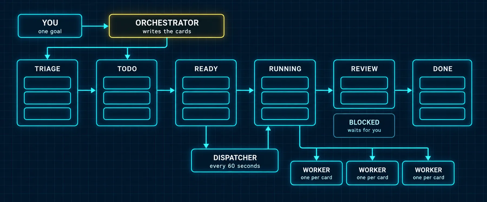

# Tip 2: Work the Board, Not the Chat



### What you are building

The move most people never make. They open Hermes, type a big ask into one chat, and babysit it: one model, one context window filling up, every step waiting on the one before, and nothing left behind except a long transcript. The board turns the same ask into cards. Each card is a contract with one owner, a body that says what done means, and a thread that survives restarts. Cards with no dependencies run in parallel on your inexpensive profiles; a card that depends on others waits, then starts with their results already in its context. You come back to summaries, artifacts, and a review lane, and the only things waiting for you are the decisions that are actually yours.

This tip is the operating manual: where the board lives, every place you can drive it from, how to write a card that gets a good result, a whole project worked end to end, and how the board combines with `/steer` and `/queue` from Tip 1.

### Chat or board

|  | One long chat | The board |
|---|---|---|
| The plan | Lives in the transcript, and compression eventually summarizes it away | Lives in card bodies and comment threads, on disk, forever |
| Parallel work | One step at a time | Every card with no open parents runs at once, one worker process each |
| Cost | Every step runs on the model you chat with | Each card runs on its assignee's model; the frontier model only plans |
| A crash or a restart | The turn is gone | A crashed worker is reclaimed and the card respawns with its whole thread |
| Review | You read everything | A review lane, with the reviewer of your choice, before anything reaches you |
| Your attention | Needed at every step | Needed when a card blocks with a question, and at the end |
| The record | Scroll back | `hermes kanban show`, `runs`, `log` and the comment thread, per card |

The rule of thumb, from the Kanban page's own comparison with delegation: use `delegate_task` for a short answer the parent needs right now; use the board when work crosses agents, must survive a restart, may need a human, or should be auditable. A worker may still call `delegate_task` inside its own card.

### What the source says

Checked against the Kanban page and the installed source (Hermes Agent v0.21.7, commit 3f2abce, October 12, 2026), with every command below run against a throwaway home.

| Fact | Detail |
|---|---|
| Where the board lives | `~/.hermes/kanban.db` for the default board; named boards at `~/.hermes/kanban/boards/<slug>/kanban.db`. `hermes kanban init` creates it and is safe to run twice |
| The columns | triage, todo, scheduled, ready, running, blocked, review, done. Archived is a filter, not a column. There is no in_progress and no canceled |
| A card | A title, a body, exactly one assignee (a profile name), parents, a priority (higher runs sooner), a workspace, optional skills, an optional model and provider for this card only, a max runtime, a retry limit, an optional goal mode, and an idempotency key |
| Where a card starts | No parents: straight to ready. Open parents: todo, promoted to ready by the dispatcher when every parent is done. `--triage` with no assignee: triage, for the decomposer |
| The dispatcher | Runs inside the gateway (`kanban.dispatch_in_gateway: true`) and ticks every 60 seconds across every board. No gateway running means ready cards wait forever; `init` and `create` both print that warning |
| A worker | A separate process per card: `hermes -p <assignee> --cli chat -q "work kanban task <id>"`, pinned to that card's board and workspace so it cannot see other cards |
| Handoffs | A child card's context opens with a Parent task results section carrying each parent's summary and metadata verbatim |
| Workspaces | scratch (the default; deleted on completion, except the files a worker declares as artifacts), `dir:<absolute path>` (kept), `worktree` (a git worktree, kept). A relative `dir:` path is accepted at create and rejected at dispatch |
| Agent tools | Fifteen `kanban_*` tools in the `kanban` toolset. A dispatched worker gets its lifecycle tools automatically. A chat profile gets them only when the toolset is enabled for that platform, and `hermes tools enable` defaults to the CLI platform |
| Failures | Two consecutive failed attempts (spawn failed, timed out, crashed) block the card as gave_up. A worker that exits without completing, blocking or requesting review is a protocol violation; three in a row blocks |
| Review | `request-review` moves a card to review, optionally reassigning it to `--reviewer <profile>`. The review lane auto-claims review cards and loads the bundled sdlc-review skill. A review is never a block |
| Blocks are typed | dependency (waits in todo, resumes on its own), needs_input and capability (wait for a human), transient (a maybe-flaky failure). The same kind of block twice after an unblock routes the card to triage, to break the loop |
| Notifications | Completed, blocked, gave_up, crashed and timed_out reach subscribed chats. `/kanban create` from a messaging platform subscribes that chat automatically |
| Limits | One host per board: a shared board across two machines is not supported. No links across boards. No tags or labels; `tenant` is the namespace. No deadline field |

### Where you work it

| Surface | How you get there | What it is for |
|---|---|---|
| The terminal | `hermes kanban <verb>`, 44 verbs | Everything, scriptable |
| Any chat | `/kanban <verb>` in the CLI chat or on Telegram, Discord and the rest | Board operations without leaving the conversation. It runs even while the agent is mid-turn |
| Plain language | Ask the planner; it calls `kanban_create`, `kanban_link`, `kanban_list` | Turning a goal into cards, once the `kanban` toolset is on for that profile and platform |
| The web dashboard | `hermes dashboard`, then the Kanban tab | Drag and drop, the card drawer, Decompose and Specify on triage cards, Nudge dispatcher |
| Hermes Desktop | The Kanban plugin, off by default: Capabilities, Plugins | A Kanban page, a running and ready pill in the status bar, native notifications while the app is open |
| Watching | `hermes kanban watch`, `tail <id>`, `log <id>`, `runs <id>` | The live event stream, one card's log, every attempt |

> ⚠️ **Two traps in the surfaces**
>
> Hermes Desktop does not offer `/kanban` in its slash palette; the composer refuses it and points you at the Kanban page, so enable the plugin. And the dashboard's plugin routes are unauthenticated by design, because they are meant for localhost: never run `hermes dashboard --host 0.0.0.0` on a machine other people can reach.

### Set it up once

The planner is your default profile, the one you chat with, and the workers are the profiles from Volume 1, Build 7. Two things decide whether the board works at all: a gateway running (the dispatcher lives there) and the `kanban` toolset on for the profile and platform you will plan from.

*`t2-setup.sh`*

```bash
hermes kanban init
hermes gateway status                       # the dispatcher lives in the gateway
hermes gateway install && hermes gateway start   # if status says it is not running

hermes kanban assignees                     # the profiles a card can be assigned to
hermes tools enable kanban                  # the planner, in the CLI chat
hermes tools enable kanban --platform telegram   # and wherever else you plan from

# A dedicated orchestrator profile, if you run one, should hold only board tools,
# per the Kanban page: kanban, gateway and memory, nothing that can implement.

hermes config set kanban.max_in_progress_per_profile 2   # optional: two cards per worker at once
hermes kanban dispatch --dry-run            # what would spawn right now, and why not
```

> 📝 **Name real profiles**
>
> An assignee that is not a profile is accepted at create without a warning, and the dispatcher then skips the card as a non-spawnable terminal lane. It never runs and nothing complains loudly. Run `hermes kanban assignees` before you write cards, and put the list in the planner's prompt.

### Write a card that gets a good result

The body is the contract. The worker reads the title and body as its whole brief; a goal-mode card's judge and the reviewer read them as the definition of done. Five habits, every one of them from the Kanban page or the worker guidance Hermes injects into every worker:

| Habit | Why |
|---|---|
| The body carries goal, context, files and the definition of done | The worker has no memory of your chat. What is not in the body does not exist |
| Decide once, stamp everywhere | Workers cannot see sibling cards. A name, a format or a price list two cards both depend on is decided by the planner and written into both bodies |
| Follow-up work is a new child card | Create it with `--parent <the done card>` and put the new evidence (a CI log, the reviewer's notes) in its body. Do not reopen a done card |
| Ask for review, do not block for it | `request-review` never trips the loop breaker. Block only on a real question, typed: needs_input when it is yours to answer |
| Declare what you made | A scratch workspace is deleted on completion; only declared artifacts survive. Use `dir:` or `worktree` when the whole folder must stay |

Use `--body-file` for anything longer than a line, so the shell never mangles quotes in the body. And put `--idempotency-key` on anything a cron job or a script creates: the same key twice returns the same card instead of a duplicate.

### A whole project, worked

The project Tip 1 started in chat, done properly: a comparison page for your product against three competitors. Three research cards run in parallel, the writer waits for all three, and the researcher reviews the draft before it reaches you.

*`t2-comparison-page.sh`*

```bash
cd /absolute/path/to/your/site

cat > /tmp/card-research.md <<'EOF'
Goal: the public pricing of <competitor>, as of today.
Context: we are writing a comparison page for <your product>. Use only public
list prices from the vendor's own site; no estimates, no third-party reviews.
Decision already made: prices in USD per seat per month, billed annually.
Files: write findings to research/<competitor>.md in the workspace.
Done when: every tier has a name, a price, and the source URL, and anything you
could not confirm is marked unconfirmed. Declare the file as an artifact.
EOF

hermes kanban create "Research: Acme pricing"   --assignee researcher --body-file /tmp/card-research.md --workspace dir:$PWD
hermes kanban create "Research: Globex pricing" --assignee researcher --body-file /tmp/card-research.md --workspace dir:$PWD
hermes kanban create "Research: Initech pricing" --assignee researcher --body-file /tmp/card-research.md --workspace dir:$PWD
# each prints: Created t_xxxxxxxx  (ready, assignee=researcher)

hermes kanban create "Write the comparison page" --assignee writer \
  --parent <id-acme> --parent <id-globex> --parent <id-initech> \
  --body-file /tmp/card-write.md --workspace dir:$PWD
# prints: Created t_xxxxxxxx  (todo, assignee=writer). It turns ready when all three parents are done.

hermes kanban watch                          # the event stream, live
hermes kanban show <id-write>                # body, parent results, comments, runs
```

Edit the competitor's name in the research body before each create, or keep one body file per competitor. The writer's body says the same kind of thing: the goal (the page), the context (the audience and the tone), the decision already made (USD, per seat, annual), the file (`pages/compare.md`), and done (a table plus three paragraphs, and `request-review` with `--reviewer researcher` so the facts get checked by the profile that gathered them).

You will rarely type those commands. The planner writes the cards for you:

*`prompt-t2-plan-the-board.md`*

```markdown
Turn this goal into kanban cards: <the goal, in one or two sentences>.

1. Run hermes kanban assignees and use only those profiles.
2. List every decision two cards would both depend on (names, formats,
   sources, units). Make each one now and tell me what you chose.
3. Write each card: a short title, one assignee, and a body with goal,
   context, the decisions that apply to it, the files it may touch, and the
   definition of done. Cards that need another card's output get it as a
   parent. Research and drafting cards go on dir:<absolute path>; code goes
   on a worktree workspace.
4. Show me the cards as a table first: title, assignee, parents, workspace.
   Create nothing until I say go.
5. After go, create them with kanban_create, run hermes kanban dispatch
   --dry-run, and tell me what will spawn and what is held and why.
```

*`prompt-t2-morning-review.md`*

```markdown
Board review. Run hermes kanban list and hermes kanban diagnostics.
Tell me, in this order: what finished since yesterday, with each card's
one-line summary and its artifacts; what is blocked and the exact question
each block is asking me; what is held by the dispatcher and why; and any
card whose assignee is not a real profile. Then propose the next cards,
as a table, and create nothing until I say go.
```

*`prompt-t2-reviewer.md`*

```markdown
You are reviewing card <id>. Read it with kanban_show, including the
parent results and the whole comment thread. Check every claim in the
draft against the research artifacts; a price with no source URL is a
finding. If it passes, complete it with a one-line verdict. If not, use
kanban_request_changes with each finding as one line, most severe first.
```

### Steer the board: how the two tips combine

The chat is where you think; the board is where work happens. Tip 1's two commands work on both.

| You want to | In the chat | On the board |
|---|---|---|
| Change direction mid-flight | `/steer` the planner while it writes cards: `/steer prices are annual billing, stamp that into every card body` | `hermes kanban comment <id> "<the correction>"`. A running worker polls its card for new comments and receives yours mid-run, through the same channel as `/steer`, after its next tool call; a worker that starts later reads it in the thread. To throw the run away instead, `hermes kanban reclaim <id> --reason "<why>"`: it stops the worker and returns the card to its queue with a fresh retry budget |
| Line up the next thing | `/queue write the cards for the launch email next` while the planner is still on this batch | A child card with `--parent`, so it starts the moment its parents finish |
| Hand a card to someone else |  | `hermes kanban reassign <id> <profile>`, with `--reclaim` if it is running |
| Pause and resume |  | `hermes kanban block <id> --kind needs_input "<the question>"`, then `unblock` |
| Answer a blocked card |  | `hermes kanban comment <id> "<your answer>"`, then `hermes kanban unblock <id>`. Fix the cause first: the same block twice routes it to triage |
| Know when it is done |  | `/kanban create` from Telegram subscribes that chat; or `hermes kanban notify-subscribe <id> --platform telegram --chat-id <id>` |

The pattern that ties it together: plan in the chat with `/steer` keeping the planner honest, queue the next planning step with `/queue` so you never wait on it, let the board run the work, and talk to the work through comments. Your attention goes where it pays: on the decisions a blocked card hands back to you.

### What changed since Volume 1

Part 10 of Volume 1 was written in July against an earlier release, and the board has moved a long way since. If you read it first, update these points to the version installed while writing this tip:

| Part 10 said | v0.21.7 does |
|---|---|
| The database lives under `~/.hermes/kanban/` | The default board is `~/.hermes/kanban.db`; named boards are `~/.hermes/kanban/boards/<slug>/kanban.db` |
| One `kanban` tool | Fifteen `kanban_*` tools in the `kanban` toolset |
| States todo, in_progress, review, done, canceled | triage, todo, scheduled, ready, running, blocked, review, done, plus archived |
| Tasks carry labels and tags | No tags or labels; `tenant` is the namespace |
| Workers poll, claim and assign themselves | The dispatcher claims and spawns; workers never poll |
| Deadlines that alert | No deadline field. `--max-runtime` kills and requeues; scheduled is a parking state with no timer |
| Per-state iteration limits | Only `kanban.max_in_progress` (host-wide) and `kanban.max_in_progress_per_profile` |
| Shared state across machines | One host per board; a shared board across two hosts is not supported |
| Blocked tasks list blocker ids | Dependencies are parent links; blocks are typed reasons |

Volume 1, Build 9 and Volume 3, Build 7 hold up, with two additions: the status list now includes scheduled, and `hermes tools enable kanban` applies to the CLI platform unless you add `--platform`.

> ⚠️ **Where the docs and the code disagree**
>
> Four things on the Kanban page did not match the installed source, so this tip follows the code. There is no `--scheduled-at` flag on `create`. `swarm` takes a repeatable `--worker PROFILE:TITLE`, not `--workers a,b,c`. There is no `/kanban here`. And `kanban.max_in_progress` unset is not unlimited everywhere: the code derives a cap from memory, except on macOS and Windows, where unset means no cap.

### Verify

- [ ] hermes gateway status shows the gateway running, and hermes kanban dispatch --dry-run lists what would spawn
- [ ] hermes kanban assignees lists every profile your cards name
- [ ] Three research cards ran at the same time, and the writer's card went from todo to ready on its own when the last one finished
- [ ] hermes kanban context on the writer's card shows a Parent task results section with all three summaries
- [ ] A comment plus a reclaim changed what a running card produced
- [ ] The draft reached review, the reviewer you named ran it, and a request for changes came back as one-line findings
- [ ] A blocked card's question reached you on your phone, and your comment plus an unblock moved it on

---

[← Back to the index](../README.md) · [Whole volume in one file](FULL-HERMES-TIPS.md)
