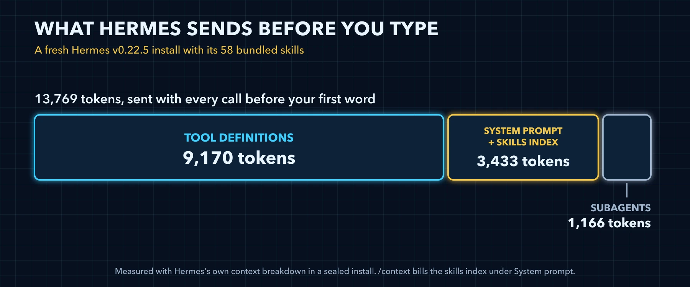
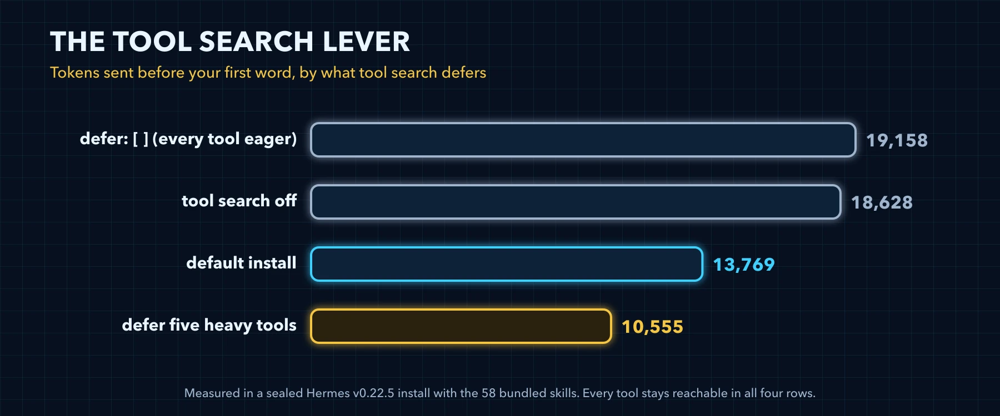
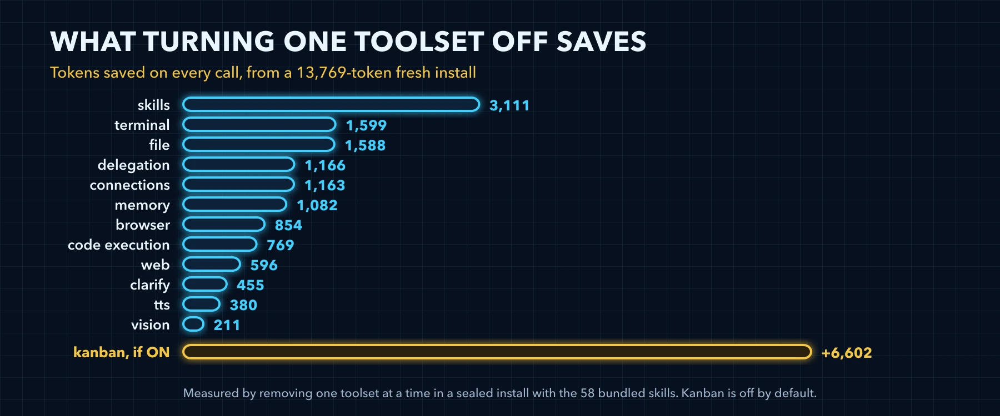
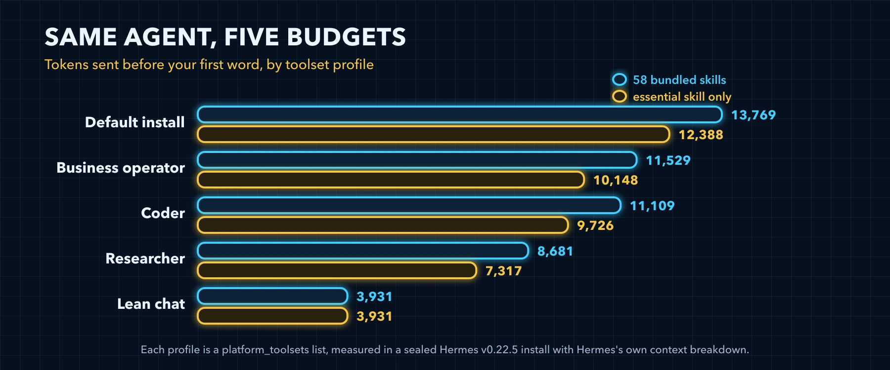

# The Hermes Tuning Masterclass


## Contents

- [Orientation](#user-content-orientation)
- **[Stage 0](#user-content-stage-0-measure-before-you-change-anything)** Measure Before You Change Anything
- **[Stage 1](#user-content-stage-1-defer-what-you-rarely-call)** Defer What You Rarely Call
- **[Stage 2](#user-content-stage-2-pick-a-toolset-profile)** Pick a Toolset Profile
- **[Stage 3](#user-content-stage-3-trim-the-skills)** Trim the Skills
- **[Stage 4](#user-content-stage-4-memory-and-context-files)** Memory and Context Files
- **[Stage 5](#user-content-stage-5-mcp-servers)** MCP Servers
- **[Stage 6](#user-content-stage-6-cache-compression-and-side-tasks)** Cache, Compression and Side Tasks
- **[Stage 7](#user-content-stage-7-cap-the-runaways)** Cap the Runaways
- **[Stage 8](#user-content-stage-8-keep-it-tuned)** Keep It Tuned
- [Where the Docs and the Code Disagree](#user-content-where-the-docs-and-the-code-disagree)
- [The Community, Credited](#user-content-the-community-credited)
- [The Tuning Ledger](#user-content-the-tuning-ledger)

---

## Orientation

The first five volumes built the agent, the app, the team and the company, and showed the habits that run them. The bonus class ranked every slash command. This volume is about what all of it costs before you say a word.

Every call a Hermes install makes starts with a fixed budget: the schemas of the tools the model can call, a system prompt with your skills index inside it, and the schema of the subagent tool. On a fresh install of v0.22.5 that is 13,769 tokens before your first word, and a large part of it serves tools you may never call. Stage 0 shows exactly where it goes.

This volume measures each lever that moves that number, in the order you should pull them, and gives you a prompt for each one that makes Hermes do the trimming itself, one approved change at a time. It tunes for the four kinds of work people run Hermes for: running a business, automating a company, research, and agentic coding. Stage 2 turns those into three ready toolset profiles, one of them shared by business and company work, and adds a lean chat profile for the terminal; every other stage applies to all four.

The order is the point. Stage 0 measures and changes nothing. Stage 1 takes the free win, deferring heavy tools so they cost almost nothing until they are used, before Stage 2 asks you to give anything up. Stages 3 to 5 trim the skills, memory, context files and MCP servers. Stages 6 and 7 move from the fixed budget to what each call and each runaway costs. Stage 8 keeps the result from drifting, with a skill that audits your install every week.

This volume does not repeat [Volume 1, Build 10](https://github.com/jasonjeske/hermes-master-class/blob/main/masterclass/build-10-tuning-and-safety.md), which it rests on. Approvals, reasoning effort basics, the side task models, compression threshold basics, turn caps, `agent.verify_on_stop`, `hermes insights`, `hermes sessions prune` and `hermes update` are set up there. Read it first if you have not; this volume goes underneath it.

> 📝 **What this volume rests on**
>
> Every token count here is Hermes's own estimate: the bytes it sends, divided by four, the same arithmetic `/context` shows. Each one was measured in a sealed, throwaway install of Hermes Agent v0.22.5 (commit bf0203a, released October 22, 2026) with the 58 bundled skills seeded, on the cli platform, and every command, flag and config key was checked against the source at that commit and the official documentation. Your numbers will differ, because your model, skills, memory and project files differ, which is why every stage starts by measuring yours. Where the docs and the code disagree, the text follows the code, and [the closing page](https://github.com/jasonjeske/hermes-master-class/blob/main/tune/99-where-the-docs-and-the-code-disagree.md) lists every disagreement found.

### How a stage prompt works

Every stage ends with one prompt. Paste it into a Hermes session on the profile you are tuning, and Hermes works through five steps:

| Step | What Hermes does |
|---|---|
| Measure | Reads what the stage is about, then runs `hermes prompt-size` with `--json` and shows the system prompt bytes, the tool schema bytes and their sum divided by four |
| Propose | Proposes one change, as the exact command or the exact lines of config.yaml before and after, with what it saves and what it costs you |
| Wait | Changes nothing until you reply yes |
| Apply | Copies config.yaml to a new dated backup next to it, `config-YYYY-MM-DD-HHMMSS.yaml`, so no earlier backup is overwritten, then makes only the change you approved |
| Verify | Runs the stage's own check, measures again, and shows before, after and the difference |

Hermes applies a config change with its own commands, never by editing config.yaml: its file tools refuse to write the active config.yaml (`tools/file_tools_write_guards.py:166-173`). So the prompts use `hermes tools` and `hermes config set`, which also takes a list written as JSON with no spaces, as in `hermes config set tools.tool_search.defer '<JSON list>'` (`hermes_cli/config.py:3207-3240`). The YAML blocks in this volume are for you, when you edit config.yaml by hand. A few changes Hermes never makes itself and hands you the exact command instead: removing bundled skills, cutting memory or rule files, editing or pinning cron jobs, installing the hermes-tune skill and updating Hermes.

The prompts measure with `hermes prompt-size` for three reasons. It runs offline, with no API call, so measuring costs nothing. Hermes can run it itself, through its terminal tool. And it reports the budget a fresh session would start with, which is the view that matters after a change: a running session keeps the system prompt and tool list it started with, so `/context` in the session that made a change still shows the old budget. A new session shows the new one.

One prompt makes one change, so every saving is measured on its own and every change can be undone on its own. How you undo it depends on what the stage touched:

| Stage | What a change touches | How you undo it |
|---|---|---|
| 1, 2, 5 and 6 | config.yaml | Copy the dated backup back over config.yaml, then open a new session |
| 3 | config.yaml, or the bundled skills on disk | The backup restores a `skills.disabled` list; `hermes skills opt-in --sync` seeds removed bundled skills again |
| 4 | config.yaml, or your memory and rule files | The backup restores config; a memory or rule file comes back only from a copy you make before you cut it |
| 7 | config.yaml, or a cron job | The backup restores config; cron jobs live in their own store, so `hermes cron edit` sets a job back |
| 8 | A new skill | `hermes skills uninstall hermes-tune`, and `hermes cron remove` with the audit's job ID if you scheduled it |

Some sessions have no terminal tool; the lean chat profile in Stage 2 turns it off, for one. The last line of every prompt covers that case: Hermes gives you each command to run and waits for your output.

Both halves of this design come from witcheer. The [Hermes Autopilot prompts](https://notwitcheer.github.io/hermes-recipes/prompts/) are read-only audits that propose a few one-line changes and stop for a yes. [Hermes Wingtips #31](https://x.com/witcheer/status/2081381590488568218) and [#48](https://x.com/witcheer/status/2089706892993941840) measure the fixed budget offline with `hermes prompt-size` and compare it before and after trimming, at zero token cost. The stage prompts here join the two: each one stays a read-only audit until you say yes, with a measurement before and after its one change.

### The ladder at a glance

| Stage | What it changes | Measured on a fresh install | Moves the fixed budget |
|---|---|---|---|
| [Stage 0](https://github.com/jasonjeske/hermes-master-class/blob/main/tune/stage-00-measure-before-you-change-anything.md) | Nothing yet: you save a baseline next to config.yaml | 13,769 tokens before your first word | No |
| [Stage 1](https://github.com/jasonjeske/hermes-master-class/blob/main/tune/stage-01-defer-what-you-rarely-call.md) | Five heavy tools move behind tool search | 13,769 to 10,555, every tool still reachable | Yes |
| [Stage 2](https://github.com/jasonjeske/hermes-master-class/blob/main/tune/stage-02-pick-a-toolset-profile.md) | The toolsets each platform turns on | 3,931 to 11,529, by profile | Yes |
| [Stage 3](https://github.com/jasonjeske/hermes-master-class/blob/main/tune/stage-03-trim-the-skills.md) | Which skills sit in the index, and what they cost to load | 12,388 with only the essential skill, minus 1,381 | Yes |
| [Stage 4](https://github.com/jasonjeske/hermes-master-class/blob/main/tune/stage-04-memory-and-context-files.md) | Memory, context files and the coding brief | Full memory plus 686; a 2.4 KB AGENTS.md plus 1,401 | Yes |
| [Stage 5](https://github.com/jasonjeske/hermes-master-class/blob/main/tune/stage-05-mcp-servers.md) | MCP servers and the tools each one exposes | A 14-tool server plus 326 in the listing, plus 54 with two tools kept | Yes, if you run MCP servers |
| [Stage 6](https://github.com/jasonjeske/hermes-master-class/blob/main/tune/stage-06-cache-compression-and-side-tasks.md) | Cache lifetime, compression and the side task models | Cost per call, outside the fixed budget | No |
| [Stage 7](https://github.com/jasonjeske/hermes-master-class/blob/main/tune/stage-07-cap-the-runaways.md) | Turn, subagent and cron limits, and the session store | Limits, not tokens: most are open by default | No |
| [Stage 8](https://github.com/jasonjeske/hermes-master-class/blob/main/tune/stage-08-keep-it-tuned.md) | A weekly audit by the hermes-tune skill | One more skill in the index, and a weekly report once you schedule it | Barely: one index row, though the scheduled audit runs a full agent session every week |

## Stage 0: Measure Before You Change Anything



### What this stage changes

Nothing in your config. You find out what your install sends before your first word, read it with the tools Hermes already has, and save the numbers as a baseline. Every later stage measures against it, and so does the weekly audit in Stage 8.

### What a fresh install sends

Three parts ride on every call before you type. Here is a fresh install of v0.22.5 with the 58 bundled skills, by Hermes's own breakdown:

| Part | Tokens | What it is |
|---|---|---|
| Tool definitions | 9,170 | The JSON schemas of the tools the model can call directly |
| System prompt | 3,433 | Hermes's instructions to the model, with the skills index inside it, about 1,720 tokens on its own |
| Subagent definitions | 1,166 | The schema of delegate_task, the tool that starts subagents |
| Total | 13,769 | Before your first word |

Turn every toolset off and the same install sends 778 tokens. Most of the difference is tool schemas, which is why Stages 1 and 2 come first.

### Three ways to read the budget

| Tool | Where you run it | What it shows | Cost |
|---|---|---|---|
| `/context` | Inside a session | The window by category: system prompt, tool definitions, rules, skills, MCP, subagent definitions, memory and conversation, then free space | Local, no provider call |
| `/context all` | Inside a session | All of that, plus the schema cost of every toolset and the index and load cost of every skill | Local, no provider call |
| `hermes prompt-size` | Your terminal, or Hermes's terminal tool | The fixed budget of a fresh session in bytes: system prompt, skills index, memory, user profile, and tool schemas by toolset; `--json` prints it as JSON, `--platform` simulates a chat platform | Offline, no API call |

All three start from bytes. `/context` divides them by four and rounds up; `hermes prompt-size` prints the bytes, so divide by four yourself. Expect the two to sit about 70 tokens apart on the same config: `hermes prompt-size` builds its tool list without the desktop_project listing line that every live session adds (Stage 1 explains that line).

### The Skills 0 trap

Run `/context` on a fresh install and there is no Skills row, although 58 skills are installed. The category comes out at 0, and a row at 0 is not printed. The index is there; it is billed as System prompt. It sits in the volatile tier of the prompt (`agent/system_prompt.py:785`), while the breakdown looks for it in the stable tier (`agent/context_breakdown.py:152`) and finds nothing. Read skill costs from `/context all` or `hermes prompt-size`, which show the index by itself.

### Reading the sample

This is `/context all` on that fresh install, exactly as Hermes printed it in the sealed run:

*`sample-context-all.txt`*

```text
Conversation is empty (no messages yet).
  user: 0, assistant: 0, tool: 0, system: 0
Model: claude-sonnet-5-5
Provider: auto

Estimated usage by category
■ System prompt        ~    3,433 tokens ~  0.3%
▣ Tool definitions     ~    9,170 tokens ~  0.9%
▦ Subagent definitions ~    1,166 tokens ~  0.1%
▨ Conversation         ~        0 tokens ~  0.0%
· Free space           ~  986,231 tokens ~ 98.6%

Context window: ~13,769 / 1,000,000 tokens (~1%)
Source: local estimate; category counts are local estimates.

Toolsets by schema cost (largest first)
  file                       4 tools ~   1,419 tokens
  skills                     3 tools ~   1,241 tokens
  delegation                 1 tools ~   1,165 tokens
  connections                1 tools ~   1,130 tokens
  browser-use                1 tools ~     831 tokens
  memory                     1 tools ~     821 tokens
  code_execution             1 tools ~     770 tokens
  (unknown)                  3 tools ~     745 tokens
  terminal                   1 tools ~     686 tokens
  web                        2 tools ~     478 tokens
  clarify                    1 tools ~     454 tokens
  tts                        1 tools ~     380 tokens
  vision                     1 tools ~     212 tokens
```

Read three things in it. The Context window line holds the total that every stage moves, 13,769 here. The toolset table is the price list Stage 2 works from, largest first. And the (unknown) row is not an error: it is the tool search bridge from Stage 1, three tools that carry the listing of every deferred tool.

### Money is a different measurement

Tokens before your first word are one number. What a session costs is another, and on v0.22.5 none of Hermes's own displays is audit grade:

| Where | What it gives you | Watch out |
|---|---|---|
| `/usage` | Session tokens and your provider's account limits | It makes a provider call, and it prints no cost line on the CLI or a chat platform, although the docs promise one |
| `/insights`, `hermes insights` | Tokens, estimated cost, models, platforms and top tools, from the local session database | A lower bound, not a bill: totals fold in cache reads and writes, and custom providers price at zero |
| The status bar | Context use, a cache hit percentage, latency | No cost: `display.show_cost` exists in config and nothing reads it |
| The dashboard's analytics | Token and cost charts | Hidden unless `dashboard.show_token_analytics` is true, and its own comment says the totals can be 10x to 100x under the bill |

For money, go to the source: your provider's bill, and the line Hermes writes to agent.log for every API call, which carries that call's cache read and cache write counts.

> ⚠️ **The request dump holds everything**
>
> `HERMES_DUMP_REQUESTS=1` writes full prompts to the sessions folder in your Hermes home, your memory and project context files included. If you use it to see exactly what goes out, delete the dumps when you are done and never share them.

### Diagnostics that spend

Two commands look like the same checkup and are not. `hermes doctor` calls your providers even without `--live`. `hermes status` reads local state only, unless you add `--deep`, which calls out. To check an install without touching a provider, use `hermes status` and the three tools above.

### The stage prompt

Paste this into a session on the profile you are tuning. It measures, proposes saving a baseline, and changes nothing else.

*`prompt-stage-0-measure.md`*

```markdown
Tune Hermes, stage 0: Measure Before You Change Anything. Work in five steps, one change at a time.
MEASURE: Run `hermes config path` to find my config.yaml and `hermes tools list` to see which toolsets are on. Run `hermes prompt-size --json` and show the system prompt bytes, the tool schema bytes and their sum divided by four as estimated tokens.
PROPOSE: Propose saving this measurement as `tune/baseline.json` in the folder that holds config.yaml: the `hermes prompt-size --json` output with two more top-level keys, `date` for today's date as YYYY-MM-DD and `version_label` for the first line of `hermes --version`. Show the exact command, or the exact lines of config.yaml before and after, and say in one line what it saves and what it costs me. Never put a key, token or password into config.
WAIT: Change nothing until I reply yes.
APPLY: Copy config.yaml to a dated backup next to it with `cp -p config.yaml config-YYYY-MM-DD-HHMMSS.yaml` in its folder, never overwriting an earlier backup, then make only the change I approved.
VERIFY: Read `tune/baseline.json` back and confirm it holds the bytes you showed me, today's `date` and the `version_label`. Run `hermes prompt-size --json` again and show a table with before, after and the difference. Remind me that this session keeps its old prompt and that a new session shows the change with /context all.
If you have no terminal tool in this session, give me each command to run and wait for my output.
```

### Verify

- [ ] `hermes prompt-size` ran offline and showed the system prompt bytes and the tool schema bytes
- [ ] tune/baseline.json sits in the folder with config.yaml, with `date` set to today and `version_label` set to the first line of `hermes --version`
- [ ] A new session's `/context all` shows your own toolset table, and you can name your three most expensive toolsets
- [ ] You know why `/context` shows no Skills row, and where the index is billed instead
- [ ] No request dump is left in your sessions folder

## Stage 1: Defer What You Rarely Call



### What this stage changes

One list in config.yaml, `tools.tool_search.defer`. Five heavy tools move behind tool search, which takes a fresh install from 13,769 tokens to 10,555, 23 percent less, and every tool stays one search away. It is the largest cut in this volume that takes nothing away, so it comes before anything that does.

### How tool search works

Tool search is on by default: `tools.tool_search.enabled` is `auto`, which means on. A deferred tool leaves the tool array the model sees. In its place, three bridge tools, tool_search, tool_describe and tool_call, carry a compact listing: each deferred tool's name and the first sentence of its description, cut at 60 characters. When the model needs a deferred tool, it finds it in the listing and calls it through the bridge.

Out of the box, the curated list defers computer_use, session_search, image_generate, todo_list, process_manage, cronjob_manage, browser_vault and twelve desktop app tools. MCP and plugin tools always defer while the bridge is on. A core tool defers only when the list names it.

That is the (unknown) row in `/context all`: 3 tools, 745 tokens. The bridge tools belong to no toolset, so Hermes has no name for the row. It is also why any session with a toolset on pays a floor of about 568 tokens: the bridge costs 498 tokens bare, and every live session adds a listing line for desktop_project, which is on the curated list.

| Setting | Default | What it does |
|---|---|---|
| `tools.tool_search.enabled` | `auto` | `auto` and `on` run the bridge; `off` sends every schema on every call |
| `tools.tool_search.defer` | The curated list | The core tools that sit behind the bridge |
| `tools.tool_search.listing_max_tokens` | `4000` | The listing's ceiling in tokens |
| `tools.tool_search.threshold_pct` | `5` | The listing's ceiling as a percent of the context window; the smaller ceiling wins |
| `tools.tool_search.search_default_limit` | `5` | Results per search when the model does not ask for a number |
| `tools.tool_search.max_search_limit` | `25` | The most results one search can return |

### What we measured

Four settings on the same fresh install, every tool reachable in all four:

| Setting | Tokens before your first word | Against the default |
|---|---|---|
| `defer: []`, every tool eager | 19,158 | plus 5,389 |
| Tool search off | 18,628 | plus 4,859 |
| The default install | 13,769 |  |
| Five heavy tools deferred as well | 10,555 | minus 3,214, 23 percent less |

Turning tool search off to keep things simple costs 4,859 tokens on every call. An empty defer list costs even more.

### The replace rule

An explicit defer list replaces the curated one; it does not add to it (`hermes_cli/config_defaults.py:2032-2039`). Write `defer: [delegate_task]`, or set that one-name list with `hermes config set`, and the curated tools all go eager again. So copy the curated list first and append, and write `defer: []` only if you mean every tool eager.

### The ready list

This is the curated list, in order, with the five heavy tools appended: the setting measured above at 10,555. To set it by hand, merge it into config.yaml; if you already have a tools section, put the defer line under its tool_search part.

*`defer-heavy.yaml`*

```yaml
# defer-heavy: the curated default names first, then five heavy tools. Hermes applies it with hermes config set tools.tool_search.defer '<JSON list>', the list as JSON with no spaces (references/ladder.md, Stage 1); merging it into config.yaml by hand is the user's path. Measured in Volume 6, Stage 1.
tools:
  tool_search:
    defer: ["computer_use", "session_search", "image_generate", "todo_list", "process_manage", "cronjob_manage", "browser_vault", "drive_preview", "gui_tour", "desktop_preview", "annotate_preview", "manage_catalog", "show_tip", "desktop_project", "close_terminal", "set_theme", "read_terminal", "read_window_below", "focus_pane", "manage_connections", "browser_exec", "text_to_speech", "vision_analyze", "execute_code"]
```

Or set the same list with one command, the way the stage prompt applies it. The list replaces whatever list is there, which is why it starts with every curated name:

*`defer-heavy.sh`*

```bash
hermes config set tools.tool_search.defer '["computer_use","session_search","image_generate","todo_list","process_manage","cronjob_manage","browser_vault","drive_preview","gui_tour","desktop_preview","annotate_preview","manage_catalog","show_tip","desktop_project","close_terminal","set_theme","read_terminal","read_window_below","focus_pane","manage_connections","browser_exec","text_to_speech","vision_analyze","execute_code"]'
```

Deferring a tool does not turn it off. Its toolset stays on, and the tool is one search away:

| Deferred tool | Its toolset | Its schema in /context all |
|---|---|---|
| manage_connections | connections | 1,130 |
| browser_exec | browser, shown as browser-use | 831 |
| execute_code | code_execution | 770 |
| text_to_speech | tts | 380 |
| vision_analyze | vision | 212 |

### The trade-off

A deferred tool still costs its listing line, about 25 tokens, and each use costs the model a search round trip. The first time a session needs it, the bridge takes 3 to 5 calls to find and run it. So defer what is heavy and occasional, and keep eager what runs every session. If you write code every session, take execute_code off the list: you would pay that round trip every time.

### The stage prompt

It reads your defer list and your recent tool use, proposes one list, and waits for your yes.

*`prompt-stage-1-defer.md`*

```markdown
Tune Hermes, stage 1: Defer What You Rarely Call. Work in five steps, one change at a time.
MEASURE: Run `hermes config get tools.tool_search.enabled` and `hermes config get tools.tool_search.defer`, and use `hermes insights --days 30` to see how often I used manage_connections, browser_exec, text_to_speech, vision_analyze and execute_code. Run `hermes prompt-size --json` and show the system prompt bytes, the tool schema bytes and their sum divided by four as estimated tokens.
PROPOSE: Propose one `hermes config set tools.tool_search.defer '<JSON list>'` command, the list written as JSON with no spaces, that keeps every name already in the list, in order, and appends whichever of those five tools I do not use every session, because the list you set replaces the whole setting instead of adding to it. If tool search is off, propose only `hermes config set tools.tool_search.enabled auto`. Apply it with that command and never edit config.yaml with write_file or patch, which Hermes refuses. Show the exact command, or the exact lines of config.yaml before and after, and say in one line what it saves and what it costs me. Never put a key, token or password into config.
WAIT: Change nothing until I reply yes.
APPLY: Copy config.yaml to a dated backup next to it with `cp -p config.yaml config-YYYY-MM-DD-HHMMSS.yaml` in its folder, never overwriting an earlier backup, then make only the change I approved.
VERIFY: Run `hermes config get tools.tool_search.defer` and confirm that every name from before is still in the list. Run `hermes prompt-size --json` again and show a table with before, after and the difference. Remind me that this session keeps its old prompt and that a new session shows the change with /context all.
If you have no terminal tool in this session, give me each command to run and wait for my output.
```

### Verify

- [ ] `hermes config get tools.tool_search.defer` lists every curated name, then the heavy tools you chose
- [ ] `hermes prompt-size` shows fewer tool schema bytes than your baseline
- [ ] In a new session, `/context all` shows a smaller total and a larger (unknown) row
- [ ] A task that needs a deferred tool still works: Hermes finds it through tool search

## Stage 2: Pick a Toolset Profile



### What this stage changes

The toolsets your CLI turns on, written as one list in config.yaml. A toolset you turn off stops sending its schemas, and any text the system prompt carries for it, on every call. Unlike Stage 1 this takes capabilities away, so pick by the work you do and keep what you use.

### What each toolset costs

Turning off one default toolset at a time on the fresh install saves what the second column shows. The third column is Hermes's own schema price from `/context all`.

| Toolset | Turning it off saves | Its schemas in /context all | What you lose |
|---|---|---|---|
| skills | 3,111 | 1,241, 3 tools | Loading, listing and writing skills, and the skills index |
| terminal | 1,599 | 686 | Shell commands and background processes; the stage prompts then ask you to run their commands |
| file | 1,588 | 1,419, 4 tools | Reading, writing, patching and searching files |
| delegation | 1,166 | 1,165, billed as subagent definitions | Subagents |
| connections | 1,163 | 1,130 | Hosted app connectors and their accounts |
| memory | 1,082 | 821 | Saving to memory; what MEMORY.md and USER.md already hold stays in the prompt (Stage 4) |
| browser | 854 | 831, as browser-use | Browser automation |
| code_execution | 769 | 770 | Python scripts that call tools |
| web | 596 | 478, 2 tools | Web search and page extraction |
| clarify | 455 | 454 | Clarifying questions with choices |
| tts | 380 | 380 | Text to speech |
| vision | 211 | 212 | Image analysis |
| cronjob | 28 | Deferred, inside the (unknown) row | Managing cron jobs from a session |
| session_search | 25 | Deferred, inside the (unknown) row | Searching past sessions |
| computer_use | 25 | Deferred, inside the (unknown) row | Desktop control |
| todo | 20 | Deferred, inside the (unknown) row | The task list for multi-step work |
| image_gen | 0 | None: gated until an image provider is set up, and deferred | Image generation |

The two columns differ because the saving is everything that leaves the request, not only the schemas: turning skills off removes the whole skills index along with its three tools, and a toolset's saving also covers any text the system prompt carries for it. Delegation is the case where the two match: its one schema is nearly its whole cost.

Kanban is off by default, and turning it on adds 6,602 tokens. The toolsets that are already deferred save only 20 to 28 tokens each, their listing lines, so turning them off buys almost nothing.



### Four ready profiles

Three profiles cover the four kinds of work, with operator serving both running a business and automating a company, and the fourth, lean chat, cuts Hermes down to chat in the terminal. Each was measured on the cli platform, on exactly the list shown, with the 58 bundled skills and with only the one essential skill that Stage 3 explains.

| Your work | Profile | Toolsets | Tokens, 58 bundled skills | Tokens, essential skill only | You give up |
|---|---|---|---|---|---|
| Agentic coding | coder | terminal, file, code_execution, web, skills, memory, todo, clarify, session_search, delegation | 11,109 | 9,726 | browser, vision, image_gen, tts, connections, cronjob, computer_use |
| Research | researcher | web, browser, file, memory, skills, session_search, clarify, todo, vision | 8,681 | 7,317 | terminal, code_execution, image_gen, tts, connections, delegation, cronjob, computer_use |
| Running a business or automating a company | operator | web, file, memory, skills, cronjob, clarify, todo, session_search, delegation, connections, terminal | 11,529 | 10,148 | browser, code_execution, vision, image_gen, tts, computer_use |
| Chat in the terminal | lean chat | web, memory, clarify, session_search, todo | 3,931 | 3,931 | browser, terminal, file, code_execution, vision, image_gen, tts, skills, connections, delegation, cronjob, computer_use |
| Anything, untuned | the default | All 17 default toolsets | 13,769 | 12,388 | Nothing |

Lean chat sends 71 percent less than the default, and the same with either skill set, because a profile without the skills toolset has no skills index at all. Its 3,931 is a CLI figure, like every figure in the table. A phone gateway takes the same list under its own platform, in `platform_toolsets.telegram` for Telegram or with `hermes tools disable --platform telegram` and the same names, and this volume did not measure that budget.

Each profile is a list to merge into config.yaml by hand. The files live in the [hermes-tune skill](https://github.com/jasonjeske/hermes-master-class/tree/main/skills/hermes-tune/references/profiles), so the skill and this page show the same lists:

*`coder.yaml`*

```yaml
# coder: agentic coding. Hermes applies this platform_toolsets.cli list with hermes config set platform_toolsets.cli '<JSON list>', the list as JSON with no spaces (references/ladder.md, Stage 2); merging it into config.yaml by hand is the user's path. Measured on the CLI in Volume 6, Stage 2.
platform_toolsets:
  cli:
    - terminal
    - file
    - code_execution
    - web
    - skills
    - memory
    - todo
    - clarify
    - session_search
    - delegation
```

*`researcher.yaml`*

```yaml
# researcher: research and reading. Hermes applies this platform_toolsets.cli list with hermes config set platform_toolsets.cli '<JSON list>', the list as JSON with no spaces (references/ladder.md, Stage 2); merging it into config.yaml by hand is the user's path. Measured on the CLI in Volume 6, Stage 2.
platform_toolsets:
  cli:
    - web
    - browser
    - file
    - memory
    - skills
    - session_search
    - clarify
    - todo
    - vision
```

*`operator.yaml`*

```yaml
# operator: running a business or automating a company. Hermes applies this platform_toolsets.cli list with hermes config set platform_toolsets.cli '<JSON list>', the list as JSON with no spaces (references/ladder.md, Stage 2); merging it into config.yaml by hand is the user's path. Measured on the CLI in Volume 6, Stage 2.
platform_toolsets:
  cli:
    - web
    - file
    - memory
    - skills
    - cronjob
    - clarify
    - todo
    - session_search
    - delegation
    - connections
    - terminal
```

*`lean-chat.yaml`*

```yaml
# lean chat, a lean terminal profile: plain chat with no files, terminal or skills. Hermes applies this platform_toolsets.cli list with hermes config set platform_toolsets.cli '<JSON list>', the list as JSON with no spaces (references/ladder.md, Stage 2); merging it into config.yaml by hand is the user's path. Measured on the CLI in Volume 6, Stage 2; on a phone gateway the same list goes under that platform, for example platform_toolsets.telegram, and that was not measured.
platform_toolsets:
  cli:
    - web
    - memory
    - clarify
    - session_search
    - todo
```

Or reach the same list from a default install with one command, the way the stage prompt applies it. None of the four names `--platform`, so each changes the CLI's list, `platform_toolsets.cli`, the lean chat command included:

*`coder.sh`*

```bash
hermes tools disable browser vision image_gen tts connections cronjob computer_use
```

*`researcher.sh`*

```bash
hermes tools disable terminal code_execution image_gen tts connections delegation cronjob computer_use
```

*`operator.sh`*

```bash
hermes tools disable browser code_execution vision image_gen tts computer_use
```

*`lean-chat.sh`*

```bash
hermes tools disable browser terminal file code_execution vision image_gen tts skills connections delegation cronjob computer_use
```

### Applying a profile

`hermes tools disable` saves your choice as an explicit `platform_toolsets.cli` list in config.yaml. In our test config it also rewrote the model block as it saved: the `model:` line inside it became a `default:` line. Expect both in the diff against your dated backup.

The top-level `toolsets:` key is legacy; editing it changes nothing, so use `platform_toolsets.cli` or `hermes tools` instead. `agent.disabled_toolsets` is the other lever: it subtracts toolsets on every platform at once, after everything else, so it always wins. It reaches cron too: every cron job loses those toolsets, whatever toolsets the job names, and nothing warns you (`cron/scheduler.py:414-433`). Put terminal there and the weekly audit in Stage 8, which runs on the terminal and file toolsets, can no longer run the commands it measures with.

Each chat platform keeps its own list. Add `--platform telegram` to `hermes tools disable` to trim Telegram's, which lands in `platform_toolsets.telegram`, and measure it with `hermes prompt-size --platform telegram --json`. Giving every platform its own smaller toolset is a habit [witcheer](https://x.com/witcheer/status/2089706892993941840) recommends.

A toolset profile is a list inside one Hermes home. It is not a Hermes profile, the separate homes of [Volume 1, Build 7](https://github.com/jasonjeske/hermes-master-class/blob/main/masterclass/build-07-profiles.md). To give one of those a toolset profile, start the command with `hermes -p <name>`, as in `hermes -p coder tools disable browser vision image_gen tts connections cronjob computer_use`.

To pick from your own history, run `hermes insights --days 30`: its top tools show what you actually use. A toolset whose tools never appear there is a candidate to turn off.

Whatever you change lands next session. The session you change it from keeps its tool list until it ends, so open a new one before you measure with `/context`.

### The stage prompt

It reads your toolsets and your recent tool use, proposes one profile, and waits for your yes.

*`prompt-stage-2-profile.md`*

```markdown
Tune Hermes, stage 2: Pick a Toolset Profile. Work in five steps, one change at a time.
MEASURE: Run `hermes tools list` to see which toolsets are on and `hermes insights --days 30` to see which tools I used in the last 30 days. Run `hermes prompt-size --json` and show the system prompt bytes, the tool schema bytes and their sum divided by four as estimated tokens.
PROPOSE: Propose the one profile that fits how I use you, as the `hermes tools disable` command that gets there from what is on now (with `hermes tools enable` for anything it keeps that is off), and name every toolset it turns off that I used in the last 30 days. The profiles keep these toolsets: coder keeps terminal, file, code_execution, web, skills, memory, todo, clarify, session_search and delegation; researcher keeps web, browser, file, memory, skills, session_search, clarify, todo and vision; operator keeps web, file, memory, skills, cronjob, clarify, todo, session_search, delegation, connections and terminal; lean chat keeps web, memory, clarify, session_search and todo. Apply it with those commands and never edit config.yaml with write_file or patch, which Hermes refuses. Show the exact command, or the exact lines of config.yaml before and after, and say in one line what it saves and what it costs me. Never put a key, token or password into config.
WAIT: Change nothing until I reply yes.
APPLY: Copy config.yaml to a dated backup next to it with `cp -p config.yaml config-YYYY-MM-DD-HHMMSS.yaml` in its folder, never overwriting an earlier backup, then make only the change I approved.
VERIFY: Run `hermes tools list` again and confirm that exactly the profile's toolsets are on. Run `hermes prompt-size --json` again and show a table with before, after and the difference. Remind me that this session keeps its old prompt and that a new session shows the change with /context all.
If you have no terminal tool in this session, give me each command to run and wait for my output.
```

### Verify

- [ ] `hermes tools list` shows exactly the toolsets of the profile you picked
- [ ] config.yaml holds an explicit `platform_toolsets.cli` list, and a dated `config-YYYY-MM-DD-HHMMSS.yaml` backup beside it holds the old config
- [ ] `hermes prompt-size` shows fewer tool schema bytes than after Stage 1
- [ ] A new session still does the work you picked the profile for
- [ ] Every chat platform you use has its own list, measured with `--platform`

## Stage 3: Trim the Skills

### What this stage changes

The skills index: the list of every installed skill that rides in the system prompt of every call. This stage turns off the skills you never use, so their rows leave the index and the model stops being told to consider them. Every skill you keep works as before, and no skill file is edited.

Keep the skills you use. The ones you never call cost you twice: once in the index on every call, and again whenever the model loads one it did not need.

### What the skills block costs

On a fresh install the system prompt is 3,433 tokens, and about 1,720 of them are the skills block: a short header, one row per skill with its description cut to 60 characters, and a line for each category. The 58 bundled skills render about 6,871 characters, and every skill you install adds a row. `/context` counts the whole block as System prompt, not as Skills, for the reason [Stage 0](https://github.com/jasonjeske/hermes-master-class/blob/main/tune/stage-00-measure-before-you-change-anything.md) explains.

The second bill comes from the header. It tells the model to load any skill that is even partially relevant to the task, so a long index also means more loads. A load (`skill_view`) puts the whole SKILL.md into the conversation, where it stays for the rest of the session. The largest bundled skills are `claude-code` at 35,175 bytes, `humanizer` at 34,463 and `p5js` at 27,534. `hermes prompt-size --json` lists every skill with the size of its SKILL.md, which is what a load costs, so the expensive ones are easy to find.

A description longer than 60 characters shows in the index as its first 57 characters and three dots. Whatever comes later, often the part that says when to use the skill, never reaches the model. [witcheer](https://x.com/witcheer/status/2069828190197973337) caught `/learn` drafting descriptions past that limit. Keep every description you write to one sentence of 60 characters or fewer.

[Ryan Underdown](https://bobatron.com/blog/hermes-system-prompt) traced how Hermes builds its system prompt and measured how much of it the skills index takes, the same question this stage starts from. His fix was a patched `agent/prompt_builder.py`. `hermes update` replaces that file, and v0.22.5 has no plugin seam for the index, so this stage uses the levers Hermes ships.

### What we measured

A sealed install of v0.22.5 with the 58 bundled skills sends 13,769 tokens before your first word.

| What you change | Saves | What you give up |
|---|---|---|
| Opt out to the one essential skill, `hermes-agent` (12,388 left) | 1,381 | The other bundled skills, until you opt back in |
| Turn the skills toolset off, as the lean chat profile in Stage 2 does | 3,111 | Every skill: the index, the three skill tools (1,241 in `/context all`) and their guidance |
| Disable the skills you never use | One index row each | Only those skills |

No skills toolset means no index at all, so the second row is everything skills cost before the first load. Opting out keeps the skill tools and one skill. Disabling keeps everything you still use, which is why the stage prompt starts there.

### The levers

| Lever | What it does | Use it when |
|---|---|---|
| `hermes skills config` | An interactive checklist of your skills, for every platform or one. It takes no argument and writes `skills.disabled` or `skills.platform_disabled.<platform>` | You want to pick by hand |
| `skills.disabled` | Takes the named skills out of the index, the skill list and slash commands, and refuses a load of them. `hermes-agent` can never be disabled. Set it with `hermes config set` and a JSON list | You know the names, as the stage prompt does |
| `skills.platform_disabled.<platform>` | The same, on one platform only | A skill belongs in the terminal but not on Telegram |
| `hermes skills opt-out` | Stops seeding the bundled skills into this profile. Alone it changes nothing you can see: the copies stay on disk and in the index until you add `--remove`, which asks before it deletes the unmodified ones. `hermes skills opt-in --sync` brings them back | You use none of the bundled skills |
| `skills.auto_load` | Pins whole skills into the stable part of every session's system prompt | Almost never: every pinned SKILL.md rides every call in full |
| `-s` or `--skills` at launch | Preloads a skill for that one launch | You want a skill in one session without pinning it |

Set each disable key with one command, the list written as JSON with no spaces. A set replaces the whole list, so keep every name already in it. The names are three of the largest bundled skills; use names from your own list.

*`skills-disabled.sh`*

```bash
hermes config set skills.disabled '["p5js","humanizer"]'
hermes config set skills.platform_disabled.telegram '["claude-code"]'
```

By hand, the same two keys look like this in config.yaml:

*`skills-disabled.yaml`*

```yaml
skills:
  disabled:
    - p5js
    - humanizer
  platform_disabled:
    telegram:
      - claude-code
```

> ⚠️ **Why the stage prompt uses config set**
>
> Hermes refuses `write_file` and `patch` on the config.yaml it runs with (`tools/file_tools_write_guards.py:168`), so the stage prompt changes config only with `hermes config set`, which turns a quoted JSON list into a real list (`hermes_cli/config.py:3207`). For `skills.disabled` it then warns that the key is not a recognized config key. That notice is expected: Hermes reads the key anyway (`agent/skill_utils.py:286`).

### The curator

The curator keeps the skills the agent writes for itself from piling up. By default it runs at most once every 168 hours, after two hours without activity, marks a skill stale after 14 days without use and archives it after 30, and an archived skill can be restored. It never touches hub skills, and by default it leaves bundled skills alone too, so it will not trim the 58 above unless you set `curator.prune_builtins: true`. Its default run spends no tokens: only `curator.consolidate: true` adds a model pass. `hermes curator run --dry-run` reports what a run would do and changes nothing.

The 152 optional skills that ship with Hermes stay out of the index until you install one. An install reaches the prompt in your next session unless `/skills install` gets `--now`, and a session that is already running keeps its index and gets a short note listing what changed.

### The stage prompt

Paste it into a Hermes session that has its terminal tool.

*`prompt-stage-3-skills.md`*

```markdown
Tune Hermes, stage 3: Trim the Skills. Work in five steps, one change at a time.
MEASURE: Read my enabled skills with `hermes skills list --enabled-only`, how often each one has been used with `hermes curator usage`, the skills already turned off with `hermes config get skills.disabled` (not set means none, and its notice that the key is not recognized is expected), and any pinned skills with `hermes config get skills.auto_load`. Run `hermes prompt-size --json` and show the system prompt bytes, the tool schema bytes and their sum divided by four as estimated tokens.
PROPOSE: One `hermes config set skills.disabled '<JSON list>'` command, the JSON with no spaces, that keeps every name already in the list, adds the skills I have never used, largest SKILL.md first, and leaves hermes-agent on. If I use none of the bundled skills, give me `hermes skills opt-out --remove` to run myself instead, and say that it asks before it deletes their unmodified copies and that `hermes skills opt-in --sync` brings them back. Show the exact command and say in one line what it saves and what it costs me. Never put a key, token or password into config.
WAIT: Change nothing until I reply yes.
APPLY: If I chose the opt-out, wait until I tell you I ran it. Otherwise run `cp -p config.yaml config-YYYY-MM-DD-HHMMSS.yaml` in the folder `hermes config path` points to, with the current date and time and never over an existing backup, then run only the command I approved. Never edit config.yaml with write_file or patch.
VERIFY: Run `hermes skills list --enabled-only` again and show that the skills I turned off are gone and hermes-agent is still there. Run `hermes prompt-size --json` again and show a table with before, after and the difference. Remind me that this session keeps its old prompt and that a new session shows the change with /context all.
If you have no terminal tool in this session, give me each command to run and wait for my output.
```

### Verify

- [ ] `hermes prompt-size --json` shows fewer system prompt bytes than before this stage
- [ ] `hermes skills list --enabled-only` no longer shows the skills you turned off, and still shows `hermes-agent`
- [ ] `hermes config get skills.auto_load` prints an empty list, or only skills you use in every session
- [ ] A new session's `/context all` no longer lists the skills you turned off
- [ ] A `config-YYYY-MM-DD-HHMMSS.yaml` backup from this stage sits beside config.yaml, unless you only opted out

## Stage 4: Memory and Context Files

### What this stage changes

The text Hermes adds to the system prompt from files: your memory (MEMORY.md and USER.md), the project rule file it finds in your working folder, and SOUL.md. Each of them rides every call, so this stage makes each one earn its place. It turns nothing off unless you choose to.

### Memory

Memory is two small stores: MEMORY.md for what the agent learns, USER.md for what it knows about you. Both go into the system prompt of every call. Their caps are `memory.memory_char_limit` (2,200 characters) and `memory.user_char_limit` (1,375), and a write past a cap is refused. We filled both toward their caps, 1,340 and 710 characters, and measured:

| Setup | Tokens before your first word | Change |
|---|---|---|
| Fresh install, empty memory | 13,769 |  |
| Memory filled toward its caps | 14,456 | plus 686 in the memory row |
| Same, with the memory toolset off | 13,374 | the memory row stays at 686 |
| Same, with both memory flags set to false | 12,687 | minus 1,769 from full memory |

Turning the memory toolset off removes the memory tool (821 tokens of schema in `/context all`) and its guidance, 1,082 tokens in all, but MEMORY.md and USER.md stay in the prompt. Only the two flags take them out:

*`memory-off.sh`*

```bash
hermes config set memory.memory_enabled false
hermes config set memory.user_profile_enabled false
```

That also ends memory across sessions, so most people should keep memory and keep it lean. A rule from [Mervin Praison](https://mer.vin/2026/05/soul-md-for-ai-agents-30-80-line-identity-blueprint-before-memory-or-tools/) is a good one to adopt: memory holds durable facts, procedures belong in skills, task logs stay out, and stale entries go at a monthly review. A task log in MEMORY.md is paid on every call. To cut an entry, edit MEMORY.md or USER.md in the memories folder beside config.yaml: a line holding only a section sign separates entries, so remove one of those lines with the entry.

Watch the caps too. A store at nine tenths of its cap or more is close to refusing writes, and it is the line the weekly audit in [Stage 8](https://github.com/jasonjeske/hermes-master-class/blob/main/tune/stage-08-keep-it-tuned.md) reports on. Count a store with `wc -m` on its file: the cap counts characters, while `hermes prompt-size` reports each store in bytes with about 335 bytes of header around it.

Memory is also a frozen snapshot, as [witcheer](https://x.com/witcheer/status/2069020659829608570) points out. A save during a session reaches the file at once but reaches the prompt only in your next session, which keeps the prompt cache warm. So trim memory, then start a new session to see the saving.

### Context files

Hermes adds the project rule file it finds for your working folder to the system prompt, and the file costs more than its own size. In our install a 2,406-byte AGENTS.md, about 602 tokens on its own, cost 1,401 tokens: 15,170 against 13,769. Nearly all the rest is what the file switches on. An AGENTS.md marks the folder as a code project (`agent/coding_context.py:35`), so Hermes adds its coding brief to the system prompt and a short workspace snapshot after the file. `/context` shows 876 tokens in the rules row and 525 more in the system prompt.

Only one kind of rule file loads: the first one Hermes finds with content, in this order ([witcheer](https://x.com/witcheer/status/2069385776756895880) flagged the trap):

| Order | File | Where Hermes looks |
|---|---|---|
| 1 | `.hermes.md` or `HERMES.md` | The working folder, then each parent up to the git root |
| 2 | The `AGENTS.md` chain | Every folder from the git root down to the working folder; in each one, `AGENTS.override.md` wins over `AGENTS.md` |
| 3 | `CLAUDE.md` | The working folder only |
| 4 | `.cursorrules` and `.cursor/rules/*.mdc` | The working folder only; every one of these files with content loads |

So a stray `.hermes.md` silently replaces your AGENTS.md, and a CLAUDE.md next to an AGENTS.md never loads. Keep one rule file per project, and keep it short. For a personal version of a team's AGENTS.md, put an `AGENTS.override.md` beside it and keep it out of git ([witcheer](https://x.com/witcheer/status/2096481734388858931)); in that folder it loads instead of the shared file.

Three more costs hide in these files. Every subagent reads the AGENTS.md chain again (not SOUL.md), so a long rule file is paid once more by each child. A context file that takes more than 5 seconds to read, such as a cloud-synced file that is only stored online, is skipped with only a line in agent.log. And each file is capped, by default at a slice of the model's window and never below 20,000 characters; Hermes keeps the start and the end of a longer one and marks what it cut.

SOUL.md is the agent's identity. It loads from your Hermes home in every session, never from the working folder, and it rides every call. Hermes builds the system prompt once per session, so an edit to SOUL.md applies in your next session, whatever the comment in the seeded file says.

### Coding context

`agent.coding_context` decides how much coding help rides along. The default, `auto`, adds a coding brief and a live git snapshot when you work interactively in a code project. `focus` goes further once Hermes detects a coding project: it narrows the toolsets to the coding set and shows the non-coding skill categories as names only, without descriptions. In an empty folder it changed nothing in our install, because there was no project to detect. If you code in one repository all day, try it there and measure it with the stage prompt:

*`coding-focus.sh`*

```bash
hermes config set agent.coding_context focus
```

### The stage prompt

Paste it into a Hermes session that has its terminal tool, started in the project folder you work in.

*`prompt-stage-4-memory.md`*

```markdown
Tune Hermes, stage 4: Memory and Context Files. Work in five steps, one change at a time.
MEASURE: Read my memory caps with `hermes config get memory.memory_char_limit` and `hermes config get memory.user_char_limit`, and count MEMORY.md and USER.md in the memories folder beside config.yaml with `wc -m`, the counts only, never their text. Then review the memory, user profile and project rule file in your system prompt, and mark every entry that is a task log, out of date or said twice. Run `hermes prompt-size --json` and show the system prompt bytes, the tool schema bytes and their sum divided by four as estimated tokens.
PROPOSE: The one change that saves the most: memory cut down to durable facts, a shorter project rule file, or `hermes config set memory.memory_enabled false` and `hermes config set memory.user_profile_enabled false` if I do not use memory. For a memory or rule file, quote the exact entries or lines to cut and give me the `cp -p` command that keeps a dated copy beside the file, because I make the copy and the cut myself. Show the exact command and say in one line what it saves and what it costs me. Never put a key, token or password into config.
WAIT: Change nothing until I reply yes.
APPLY: For a memory or rule file, change nothing and wait until I tell you the cut is made. For the config change, run `cp -p config.yaml config-YYYY-MM-DD-HHMMSS.yaml` in the folder `hermes config path` points to, with the current date and time and never over an existing backup, then run only the commands I approved. Never edit config.yaml with write_file or patch.
VERIFY: Count MEMORY.md and USER.md again with `wc -m` and compare them with the first counts and with their caps. Run `hermes prompt-size --json` again and show a table with before, after and the difference. Remind me that this session keeps its old prompt and that a new session shows the change with /context all.
If you have no terminal tool in this session, give me each command to run and wait for my output.
```

### Verify

- [ ] `hermes prompt-size --json` shows the size you trimmed smaller than before this stage
- [ ] `wc -m` counts MEMORY.md and USER.md under nine tenths of `memory.memory_char_limit` and `memory.user_char_limit`
- [ ] Every memory entry left is a durable fact, with no task logs and nothing said twice
- [ ] Exactly one project rule file loads in your working folder, and a new session's `/context` lists it
- [ ] A dated copy of every file this stage changed sits next to it, config.yaml as `config-YYYY-MM-DD-HHMMSS.yaml`

## Stage 5: MCP Servers

### What this stage changes

Which MCP tools each server puts in front of the model. With tool search on, an MCP server is cheap, and this stage makes it cheaper: each server keeps only the tools you use, and a server you stopped using stops riding along. It changes a server's tools setting or its enabled flag, never its command, arguments or credentials.

### How MCP tools are billed

With tool search on, as it is by default, Hermes defers every MCP tool. Its schema leaves the request, and the tool becomes one line, a name and a short first sentence, in the listing that the three bridge tools carry ([Stage 1](https://github.com/jasonjeske/hermes-master-class/blob/main/tune/stage-01-defer-what-you-rarely-call.md) explains the bridge). `/context` reports MCP as 0 and bills that listing in the (unknown) row of `/context all`: 3 tools and 745 tokens on a fresh install.

The listing has a ceiling: the smaller of `tools.tool_search.listing_max_tokens` (4,000 tokens) and `tools.tool_search.threshold_pct` (5 percent) of the model's window. Past it, Hermes shortens the listing to names only, then to one line per server, starting with the largest server. Turn tool search off and every MCP schema rides every call in full, with no ceiling, so leave it on.

### What we measured

The official filesystem MCP server, 14 tools, added to a fresh install:

| Setup | Tokens before your first word | Change |
|---|---|---|
| Fresh install | 13,769 |  |
| Plus the filesystem server, all 14 tools deferred | 14,095 | plus 326 |
| Same server, with an include list of 2 tools | 13,823 | plus 54 |

The server is cheap because tool search defers it. The include list still cut its listing from 326 tokens to 54, and the tools it leaves out are not registered at all.

### Trim each server

Name the tools you use, one command per server, the list written as JSON with no spaces:

*`mcp-tools.sh`*

```bash
hermes config set mcp_servers.filesystem.tools.include '["read_text_file","list_directory"]'
```

By hand in config.yaml, this is the whole block to change; the server's own lines stay as they are:

*`mcp-tools.yaml`*

```yaml
mcp_servers:
  filesystem:
    tools:
      include: [read_text_file, list_directory]
```

`mcp_servers.<name>.tools.include` takes exact names or shell-style wildcards, and it wins over `mcp_servers.<name>.tools.exclude` when a server has both; an empty include list registers nothing. `mcp_servers.<name>.tools.resources: false` and `mcp_servers.<name>.tools.prompts: false` drop the four utility tools a server gets when it offers resources or prompts. `mcp_servers.<name>.enabled: false` turns a server off everywhere and keeps its settings for later. To pick from a list instead of typing names, `hermes mcp configure <name>` toggles a server's tool selection.

### Startup and subagents

`mcp_servers.<name>.lazy: true` defers a server's connection until it is needed, which speeds up startup. Two other settings decide where a server's listing is paid again. `delegation.inherit_mcp_toolsets` is true by default, so a subagent given a narrower toolset list still keeps the parent's MCP servers. If your subagents never need MCP tools, turn it off:

*`mcp-subagents.sh`*

```bash
hermes config set delegation.inherit_mcp_toolsets false
```

To keep MCP off one platform, put `no_mcp` in that platform's list under `platform_toolsets`, the lists [Stage 2](https://github.com/jasonjeske/hermes-master-class/blob/main/tune/stage-02-pick-a-toolset-profile.md) builds. A cron job that sets its own toolsets also gets every enabled server unless its list has `no_mcp`.

### The stage prompt

Paste it into a Hermes session that has its terminal tool. Measure MCP with `/context all`: the (unknown) row is where its listing is billed. `hermes prompt-size` cannot show it: that command never starts your MCP servers, so its tool bytes leave every MCP tool out (`hermes_cli/main.py:2866` starts MCP in the background only for chat sessions). Read a server's settings one key at a time, never with `hermes config show` or a bare `hermes config get mcp_servers`: both print launch commands, arguments and URLs unmasked, and those can carry tokens.

*`prompt-stage-5-mcp.md`*

```markdown
Tune Hermes, stage 5: MCP Servers. Work in five steps, one change at a time.
MEASURE: List my MCP servers with `hermes mcp list` and show me only its Name, Tools and Status columns, then read each server's tools setting with `hermes config get mcp_servers.<name>.tools`. Never run `hermes config show` or a bare `hermes config get mcp_servers`: they print launch commands, arguments and URLs unmasked. Ask me which of each server's tools I use. Ask me to run /context all and paste its (unknown) row, where the listing that carries MCP tools is billed. That row is this stage's measure, because `hermes prompt-size` never starts MCP servers. Also run `hermes prompt-size --json` and note its estimated tokens, the fixed budget without MCP.
PROPOSE: For one server, either `hermes config set mcp_servers.<name>.tools.include '<JSON list>'` with only the tools I use, the JSON with no spaces, or `hermes config set mcp_servers.<name>.enabled false` for a server I no longer use. Never show or change its launch command, arguments, env or headers. Show the exact command and say in one line what it saves and what it costs me. Never put a key, token or password into config.
WAIT: Change nothing until I reply yes.
APPLY: Run `cp -p config.yaml config-YYYY-MM-DD-HHMMSS.yaml` in the folder `hermes config path` points to, with the current date and time and never over an existing backup, then run only the command I approved. Never edit config.yaml with write_file or patch.
VERIFY: Read the server's setting again with `hermes config get mcp_servers.<name>.tools` or the Status column of `hermes mcp list`, then ask me to open a new session, run /context all and paste the (unknown) row. Run `hermes prompt-size --json` again and confirm its estimated tokens did not move, since it never counts MCP tools. Show a table of the (unknown) row with before, after and the difference. Remind me that this session keeps its old prompt and that a new session shows the change with /context all.
If you have no terminal tool in this session, give me each command to run and wait for my output.
```

### Verify

- [ ] `hermes config get mcp_servers.<name>.tools` prints the include list you approved
- [ ] A new session's `/context all` shows a smaller (unknown) row than before this stage
- [ ] Every server you no longer use shows as disabled in the Status column of `hermes mcp list`
- [ ] `hermes config get tools.tool_search.enabled` prints auto or on, never off
- [ ] A `config-YYYY-MM-DD-HHMMSS.yaml` backup from this stage sits beside config.yaml

## Stage 6: Cache, Compression and Side Tasks

### What this stage changes

Stages 0 to 5 cut what Hermes sends before your first word. This stage works on what you pay to send it again and again: whether the provider can read that prefix from its cache or has to write it again, when a long session gets rewritten by compaction, and which model runs the side tasks you never see.

None of these levers moves the fixed budget. The prompt-size numbers stay where Stage 5 left them, and the stage prompt shows that on purpose: the change lands on the cost of each call, not on what each call sends.

[Volume 1 Build 10](https://github.com/jasonjeske/hermes-master-class/blob/main/masterclass/build-10-tuning-and-safety.md) set the basics: approval modes, the compression threshold and a cheaper model for side tasks. This stage goes underneath them, and it corrects one number Build 10 took from the docs.

### The cache lasts one session

Hermes builds the system prompt and the tool list once per session and sends the same bytes on every call after that. That is how it keeps the provider's prefix cache warm, and it is why most of what you change in a running session waits for the next one.

| In a running session | Breaks the cache | What happens |
|---|---|---|
| A memory write | No | It reaches disk now and the prompt at the next session or compaction |
| A skill install or edit | No | A short note in the next message lists the change; the index itself updates next session |
| An edit to SOUL.md or AGENTS.md | No | Read again at the next session or compaction |
| Midnight | No | The date line stays fixed to the start of the session |
| A model switch with `/model` | Yes | The prompt is rebuilt and the new model starts with a cold cache |
| A toolset change | Yes | The tool list heads every request, so everything is written again |
| A compaction | Yes | The system prompt is rebuilt and the whole prefix is written again |
| Resuming from another folder | Yes | Context files depend on the folder, so the prompt is rebuilt |

The habit that falls out of the table: pick the model before you start, and change it between sessions, not inside one. A switch in a long session pays to write the whole conversation again at the new model's price. The habit is [witcheer's](https://x.com/witcheer/status/2074153526222114974): batch your model switches, or start a fresh session, instead of going back and forth in one.

How long a cached prefix lives is `prompt_caching.cache_ttl`, and the default is `5m`. A one hour cache write costs 2x the base input price against 1.25x for five minutes, so the long tier pays off only when you come back to a session after a pause. `auto`, opt-in since v0.21.5, picks per session: one hour for sessions a person types into (CLI, TUI, Desktop and the messaging platforms) and five minutes for subagents, cron, one-shots and the other machine-paced runs. On an install whose sessions are parked and resumed through the day, the docs put the cut in the interactive cache-write bill at roughly 40%; the code's own note, from one install, says 42%.

*`cache-ttl.sh`*

```bash
hermes config set prompt_caching.cache_ttl auto
```

A value such as `off` or `false` in `prompt_caching.cache_ttl` turns caching off. The docs say no such switch exists, but it does. It earns its place only on plans that bill cache writes and behind proxies that add their own cache markers, so leave caching on otherwise.

Two provider routes need a check of their own. If you run Claude through the Nous Portal, the default chat wire caches only the system prompt inside tool loops: the reports in [#141833](https://github.com/NousResearch/hermes-agent/issues/141833) show 13 to 21% cache hits, and the native wire measured 95% or better. The default stays `chat` because `native` has a cache problem of its own on the OpenRouter-served path, so treat the switch as a test: set it, run one long tool-heavy task, and watch the cache field in the status bar.

On OpenRouter, the response cache is on by default: send the identical request again within 300 seconds, the default of `openrouter.response_cache_ttl`, and you get the stored response back, tool calls included ([#70387](https://github.com/NousResearch/hermes-agent/issues/70387)). In an agent loop a replayed tool call is a stale decision, so turn it off there.

*`provider-cache.sh`*

```bash
hermes config set nous.anthropic_wire native
hermes config set openrouter.response_cache false
```

### Compression starts later than you think

`compression.threshold` defaults to 0.50, and Volume 1 Build 10 repeats that number from the docs. In v0.22.5 it holds only for models with a context window of 512K or more. For any smaller window Hermes raises the trigger to 0.75, so a 200K model compacts near 150K, not 100K. The floor only ever raises: a threshold above 0.75 makes a small model compact later, and anything below it acts as 0.75.

Each compaction is one call to a summary model. Up to 160,000 characters of history go in, and the summary that comes out is sized at 20% of the turns being compacted, never under 2,000 tokens and never over 5% of the window or 10K tokens, whichever is smaller. Then the whole new prefix is written to the cache again. That call runs on your main model unless you route it, which is the next section. A lower threshold means more compactions and smaller requests; a higher one means fewer compactions and a bigger prefix riding the cache between them.

Two things to know before you touch it. `/compress --preview` shows what a compaction would do, from local estimates, without calling any model; a real `/compress` calls the summary model. And `compression.target_ratio`, which some guides tune, does nothing under the default lean tail: it applies only when `compression.tail_mode` is `legacy`. The lean tail keeps 2.5% of the window word for word, never less than 10K or more than 25K tokens.

### Side tasks run on your main model

Hermes runs a handful of jobs beside your conversation: the compaction summary, vision, the check behind smart approvals, session titles and the background review. Each has its own block under `auxiliary`, and each block's provider defaults to `auto`, which starts with your main model. Chat on a frontier model and every side task runs on it too. Since v0.21.2 a side task never bills a provider you did not select ([#107366](https://github.com/NousResearch/hermes-agent/pull/107366)), so this is a cost problem, not a surprise on some other account.

Community authors got here first, and this stage adopts their fixes. [Azamat Safarov](https://dev.to/azamat_safarov/hermes-agent-burned-603m-tokens-behind-my-back-i-cut-background-costs-by-up-to-125x-43oi) traced runaway background spend to side tasks left on `auto` and pinned every one of them to a provider and model chosen on purpose. [Tonbi's AI Garage](https://www.youtube.com/watch?v=NoF-YajElIM) showed the gotcha that trips most people: the summary model belongs under `auxiliary.compression`, while the top-level `compression` block holds only behavior such as `compression.threshold`. And witcheer added two refinements: a fast, inexpensive model for compaction summaries ([on summaries](https://x.com/witcheer/status/2086745372521591061)), and lower thinking for side tasks, such as `auxiliary.compression.reasoning_effort` at `low` ([on side-task thinking](https://x.com/witcheer/status/2100460797239415168)), which Build 10 already sets. The review fork ignores its own effort setting while it stays on the main model.

Route the two side tasks that read the most history, by provider and model only. The block below is an example, not a drop-in: `<cheap-model>` stands for a smaller model your provider serves, and `openrouter` for whichever provider you use. Merge the lines into config.yaml yourself, or let the stage prompt set them one key at a time with `hermes config set`:

*`side-tasks.yaml`*

```yaml
auxiliary:
  compression:
    provider: openrouter
    model: <cheap-model>
  background_review:
    provider: openrouter
    model: <cheap-model>
```

Pick a provider you already have a key for. The key stays where Hermes already keeps it, never in this block. What it costs you: the summary is what a long session carries forward after compaction, so try the cheaper model on one long session before you trust it.

### The review fork and smart approvals

After some replies Hermes forks a background review that decides what to save to memory and which skills to write or patch. It fires every 10 user turns for memory and every 10 tool iterations for skills, runs up to 16 iterations, and costs about 30K tokens an event by the code's own note, a figure this volume did not measure. On `auto` it replays your whole conversation on the main model, reading the warm cache. Routed to any other model it replays a shorter digest instead, which the docs and the code put at about 3 to 5x cheaper. Cron runs never fork it.

You have two levers: route it to a cheaper model as in the lines above, or switch the automatic review off. Off, the review no longer runs after turns on its own; the memory tool still works in the conversation, and `/refine` runs a review whenever you ask for one.

*`review-off.sh`*

```bash
hermes config set auxiliary.background_review.enabled false
```

`approvals.mode` defaults to `smart`, and a smart approval asks a side-task model about every command it flags as dangerous: one small call per flagged command, on your main model unless `auxiliary.approval` is routed. `manual` drops that call and asks you every time instead; [Volume 1 Build 10](https://github.com/jasonjeske/hermes-master-class/blob/main/masterclass/build-10-tuning-and-safety.md) covers what each mode lets through. Session titles are the last small one: `auxiliary.title_generation.model_upgrade_enabled` set to `false` keeps the free title Hermes derives on its own and skips the model call.

### The stage prompt

*`prompt-stage-6-runtime.md`*

```markdown
Tune Hermes, stage 6: Cache, Compression and Side Tasks. Work in five steps, one change at a time.
MEASURE: Read `hermes config get prompt_caching.cache_ttl`, `hermes config get compression.threshold`, `hermes config get auxiliary.compression.provider`, `hermes config get auxiliary.background_review.enabled`, `hermes config get auxiliary.background_review.provider` and `hermes config get approvals.mode`, then tell me which model and provider you run on, its context window, and which side tasks run on it. Run `hermes prompt-size --json` and show the system prompt bytes, the tool schema bytes and their sum divided by four as estimated tokens.
PROPOSE: Propose the one change that fits how I work: `prompt_caching.cache_ttl` set to `auto` if I come back to sessions after breaks, or `auxiliary.compression` and `auxiliary.background_review` routed to a cheaper model on a provider I already use, by provider and model only, each key set with `hermes config set`. Show the exact command, or the exact lines of config.yaml before and after, and say in one line what it saves and what it costs me. Never put a key, token or password into config.
WAIT: Change nothing until I reply yes.
APPLY: Copy config.yaml to a dated backup next to it with `cp -p config.yaml config-YYYY-MM-DD-HHMMSS.yaml` in its folder, never overwriting an earlier backup, then make only the change I approved.
VERIFY: Read the changed key back with `hermes config get` and confirm that the fixed budget did not move, because this stage changes what each call costs, not what it sends. Run `hermes prompt-size --json` again and show a table with before, after and the difference. Remind me that this session keeps its old prompt and that a new session shows the change with /context all.
If you have no terminal tool in this session, give me each command to run and wait for my output.
```

### Verify

- [ ] `hermes config get prompt_caching.cache_ttl` prints the value you chose, `5m` or `auto`
- [ ] You know whether your model's window is under 512K, and so whether your threshold acts as 0.75
- [ ] `/compress --preview` in a long session showed the plan without calling a model
- [ ] `hermes config get auxiliary.compression.provider` names the provider you routed it to, or you chose to keep `auto`
- [ ] The fixed budget from the prompt-size check matches the one from before this stage

## Stage 7: Cap the Runaways

### What this stage changes

Every stage so far shrank a cost you pay on every call. This one bounds the costs that have no ceiling at all: a task that keeps calling tools, a fan-out of subagents, a search loop on a weak model, a cron job that wakes a full agent on your best model every morning. Nothing here moves the fixed budget. A cap costs you nothing until a job hits it, and then it is the difference between a stopped turn and a bill.

Turn caps, the budget warning and reasoning effort are in [Volume 1 Build 10](https://github.com/jasonjeske/hermes-master-class/blob/main/masterclass/build-10-tuning-and-safety.md), and Build 10 has the effort key right: `agent.reasoning_effort` is read on every surface even though config ships no default for it, and `/reasoning <level> --global` writes it cleanly. This stage covers what Build 10 does not.

### Open budgets

What v0.22.5 lets run without a ceiling, surface by surface:

| What can run long | The ceiling in v0.22.5 | Where you set one |
|---|---|---|
| Agent turns in the CLI or a gateway chat | None: `agent.max_turns` is empty, and empty means unlimited | `agent.max_turns` |
| Agent turns in the TUI | 500 when `agent.max_turns` is empty | `agent.max_turns` |
| A one-shot run with `hermes -z` | None: the one-shot path passes no cap | No setting reaches it in v0.22.5 |
| Iterations of one subagent | 250 | `delegation.max_iterations` |
| Subagents running at once | 10 | `delegation.max_concurrent_children` |
| `tool_search` calls in one turn | None | Hard stops, or tool search off on a weak model |

The last row is not hypothetical. In [#96247](https://github.com/NousResearch/hermes-agent/issues/96247) one session ran 1,523 `tool_search` calls, and v0.22.5 still has no per-turn cap on them. On a weak local model with a small catalog, the sure fix is to turn tool search off: the loop has nothing left to search, and every deferred schema comes back, 4,859 tokens a call on a fresh install. That is a Stage 1 change, and it moves the fixed budget. On a strong model, keep tool search and use the guardrails below.

Subagents are the other open tap. Each child is a fresh agent that pays your tool schemas and the working folder's AGENTS.md again as a cold prefix (Stage 4), and the defaults allow 250 iterations each with 10 running at once. A cheaper child model, `delegation.model` with `delegation.provider` (empty inherits yours), and a lower `delegation.max_iterations` are the levers.

### Loop guardrails

Hermes already watches for loops. Within a turn it counts repeated failing calls, calls that make no progress and identical replays, and warns in the tool result. Stopping a loop takes more: the detectors' blocks and halts, the halt after five identical replays included, all need `tool_loop_guardrails.hard_stop_enabled`, which is off by default. Hermes switches it on for you only in non-interactive runs, the gateway and cron, through `tool_loop_guardrails.non_interactive_hard_stop_enabled`, so in your own sessions the detectors only warn. Two checks work without it: web searches and subagents are capped at 50 per turn (`tool_loop_guardrails.loop_caps.max_web_searches` and `tool_loop_guardrails.loop_caps.max_subagents`), and after three smart-approval denials in a row the denial tells the model to stop trying and hand the command to you (`approvals.denial_breaker_threshold`).

[witcheer](https://x.com/witcheer/status/2098290534758408306) recommends turning the hard stop on for your own sessions as well:

*`hard-stops.sh`*

```bash
hermes config set tool_loop_guardrails.hard_stop_enabled true
```

What it does not catch: the guardrails look for identical and failing calls, so a run of different, successful searches like the one in #96247 may not trip them. That case is the tool search switch above.

### Cron jobs are full agents

A cron job is not a script with a model attached. Every fire builds a fresh agent: SOUL.md and memory every time, the whole cron toolset unless the job names its own `enabled_toolsets`, and a cold prompt cache unless fires come less than five minutes apart. Since v0.21.4 a job with no pinned model runs on your main model as it is at fire time, so moving your chat to an expensive model moves every unpinned job with it.

The cron help gives three ways to pin a model. `--model` with `--provider` pins a job to a model you name. `--pin` locks your current main model onto the job so later model changes never touch it (it is ignored when `--model` is given). And `cron.model` with `cron.model_provider` sets a fleet default for every job that names none, a tip from [witcheer](https://x.com/witcheer/status/2095722000907923465), along with pinning heavy jobs one by one. A job's model is yours to set: the cron help says the agent's own cron tool cannot set it, so the stage prompt hands you the `hermes cron edit` command instead of running it.

Three modes can skip the model, which makes them the cheapest jobs you can schedule. A job with `--no-agent` runs a script from the scripts folder of your Hermes home and delivers what it prints, with no model at all; empty output stays silent. Script-only jobs for routine chores are a pattern [witcheer's Almanac](https://x.com/witcheer/status/2108903932797796580) reported from an r/hermesagent post. A job with `--script` alone is different: the script runs first and its output goes into the agent's prompt, and an empty output still wakes the agent. Only a last line of `{"wakeAgent": false}` skips the model for that run. A job with `--monitor-script` (or `--monitor-url`) checks a source every tick and wakes the agent only when the output changed.

The block below is an example to adapt, not to run as it stands: the schedules, the tasks and the folder are placeholders for your own, `<cheap-model>` stands for a smaller model your provider serves, `openrouter` for whichever provider you use, and `<job-id>` for an ID from `hermes cron list`.

*`cron-pinned.sh`*

```bash
hermes cron create "every day at 7:30" "Summarize the files changed in ~/reports since yesterday, in three lines." --model <cheap-model> --provider openrouter
hermes cron create "0 9 * * 1" "Write the weekly status report." --pin   # keeps today's main model if you change it later
hermes cron edit <job-id> --model <cheap-model> --provider openrouter   # pins a job you already have
hermes cron list
```

The schedule grammar has traps, and the cron docs' own example falls into one:

| Schedule | What v0.22.5 does |
|---|---|
| `every 1d at 07:30` | Rejected, and so is the `every 1d at 09:00` in the cron docs |
| `every day at 7:30` or `30 7 * * *` | Runs at 7:30 every day |
| `every monday at 9am` or `0 9 * * 1` | Runs Mondays at 9:00 |
| `every 1d` | Repeats a day after each run, so the time drifts |
| `30m` | Repeats every 30 minutes; a bare duration is not a one-shot |
| `in 30m` | Runs once, 30 minutes from now |

### The session store

Hermes keeps every session in state.db, and on v0.22.5 nothing trims it unless you ask, apart from a one-time question when the disk holding it runs low. Auto-prune was on from v0.21.1 to v0.22.2 and is opt-in again from v0.22.3: `sessions.auto_prune` is `false`, with `sessions.retention_days` at 90 for when you turn it on. `hermes sessions stats` shows the size of the store, and the doctor check warns once it passes 1 GB.

Pruning by hand is a habit [witcheer](https://x.com/witcheer/status/2097201422844436642) and [Shabnam Katoch](https://www.betterclaw.io/blog/hermes-agent-bugs-fixes) both wrote up. A dry run is the safe way in, and the cost and token filters double as an audit of your most expensive sessions:

*`session-store.sh`*

```bash
hermes sessions stats
hermes sessions prune --dry-run --older-than 30
hermes sessions prune --dry-run --min-cost 1
hermes sessions prune --dry-run --min-tokens 500000
```

`--dry-run` lists what matches and changes nothing. `--older-than` takes days, a duration such as `1w`, or a date. `--min-cost` compares the actual or estimated cost Hermes recorded, in USD, which Stage 0 explains is not audit-grade, and `--min-tokens` counts input plus output. Without `--dry-run`, prune deletes after a confirmation, and pinned and archived sessions are left out unless you add their include flags.

### The stage prompt

*`prompt-stage-7-caps.md`*

```markdown
Tune Hermes, stage 7: Cap the Runaways. Work in five steps, one change at a time.
MEASURE: Read `hermes config get agent.max_turns`, `hermes config get delegation.max_iterations`, `hermes config get delegation.max_concurrent_children`, `hermes config get tool_loop_guardrails.hard_stop_enabled` and `hermes config get cron.model`, list my cron jobs with `hermes cron list`, show the size of my session store from `hermes sessions stats`, and tell me which of these budgets has no ceiling. Run `hermes prompt-size --json` and show the system prompt bytes, the tool schema bytes and their sum divided by four as estimated tokens.
PROPOSE: Propose one cap for the most open budget you found, such as `hermes config set tool_loop_guardrails.hard_stop_enabled true` for hard stops in my own sessions, or a turn limit in `agent.max_turns` or a lower `delegation.max_iterations`, set with `hermes config set`. For a cron job, give me the exact `hermes cron edit` command that pins its model for me to run in my own terminal, and never edit, pin or delete a cron job or delete a session yourself. Show the exact command, or the exact lines of config.yaml before and after, and say in one line what it saves and what it costs me. Never put a key, token or password into config.
WAIT: Change nothing until I reply yes.
APPLY: Copy config.yaml to a dated backup next to it with `cp -p config.yaml config-YYYY-MM-DD-HHMMSS.yaml` in its folder, never overwriting an earlier backup, then make only the change I approved.
VERIFY: Read the changed key back with `hermes config get`, or the changed job's schedule with `hermes cron list` and its model in cron/jobs.json, and confirm that the fixed budget did not move, because a cap bounds the worst case and sends nothing new. Run `hermes prompt-size --json` again and show a table with before, after and the difference. Remind me that this session keeps its old prompt and that a new session shows the change with /context all.
If you have no terminal tool in this session, give me each command to run and wait for my output.
```

### Verify

- [ ] `hermes config get tool_loop_guardrails.hard_stop_enabled` reads back what you approved
- [ ] Any other cap you set reads back with `hermes config get`
- [ ] You can say which model each cron job runs on, pinned or following your main model
- [ ] Every schedule you wrote reads back in `hermes cron list` at the time you meant
- [ ] `hermes sessions stats` reports the store size, and nothing was pruned without a dry run first

## Stage 8: Keep It Tuned

### What this stage changes

Everything so far tuned the install you have today. Updates change it: new tools land and defaults flip. This stage installs the hermes-tune skill. It adds one row to your skills index, the only change this stage makes to what each call sends, and it brings a weekly audit that measures, compares with your baseline and proposes changes for you to approve. The audit has a running cost of its own: if you schedule it, every run is one agent session on `cron.model`, or on your main model when that is empty, so the weekly audit section below shows how to pin it to an inexpensive model.

### Why budgets drift

The maintainers work on the fixed prefix too, and it moves both ways. Their context-burden campaign ([#95681](https://github.com/NousResearch/hermes-agent/issues/95681)) cut about 15.2K tokens a call on the CLI, and [PR #97979](https://github.com/NousResearch/hermes-agent/pull/97979) in v0.21.1 took the CLI from 10,578 to 7,306 tokens a call by deferring cold tools. Then the prefix grew from 11,595 to 14,962 tokens in five weeks as new tools landed, until [PR #137084](https://github.com/NousResearch/hermes-agent/pull/137084) in v0.22.0 took 2.1K back.

Those are the maintainers' figures from their own issues and pull requests, not this volume's measurements, so read them for direction. The direction is the lesson: a release can undo a stage you finished, or hand you a saving you never asked for, and only a measurement after the update tells you which.

### The version label trap

The first line of `hermes --version` starts with the release, v0.22.5 here, and a date in parentheses, and the rest of the line names the build, such as its channel and a commit. Only the date can mislead. It was not bumped for v0.22.5, which still shows 2026.9.24, and the release tagged v2026.9.24 is v0.21.5. Go by the release and the build, never the date, and quote the whole first line in a bug report: a report that quotes only the date can be a whole release off.

To learn whether an update is waiting and what it would touch, run the update command's two read-only checks yourself, in your own terminal:

*`version-check.sh`*

```bash
hermes update --check   # is an update waiting; installs nothing
hermes update --plan    # what an update would touch; changes nothing
```

`--check` says whether an update is available without installing anything. `--plan` shows the install kind, every running Hermes service across your profiles with the code version it runs, and how each would restart, and it changes nothing. Looking before you update is a habit from [witcheer's Almanac](https://x.com/witcheer/status/2108564754893582428).

Run both yourself. Hermes flags every `hermes update` command as dangerous, `--check` and `--plan` included, so in a session one has to pass your approval mode first and in a cron job it is refused outright. That is why the stage prompt below hands the update check to you instead of running it.

### Install the skill

*`install-hermes-tune.sh`*

```bash
hermes skills install jasonjeske/hermes-master-class/skills/hermes-tune --yes
```

Run it in your own terminal; the stage prompt hands it to you rather than installing anything itself. The command goes through the skills hub. Hermes fetches [the skill folder](https://github.com/jasonjeske/hermes-master-class/tree/main/skills/hermes-tune) from GitHub, runs its install scanner at community trust, where any high finding blocks the install, and then offers the skill's weekly audit under `/suggestions`. Install it this way and not by copying the folder into your skills directory: a copy skips the scanner, and only the hub install offers the audit.

The install takes effect in your next session. It adds one row to the skills index, and the description is 52 characters, inside the 60 the index keeps. Measure before and after, and the skills index line of the prompt-size report grows by that one row.

### Two modes

In guided tuning you load the skill in a session and it walks this ladder one stage at a time with the same five steps as the stage prompts: measure, propose one change, wait for your yes, back up config.yaml, apply, measure again. After you confirm the result, it refreshes `tune/baseline.json`. In audit mode the scheduled job runs it: it measures, compares with the saved baseline, writes a report and proposes changes, and its instructions are to change nothing else, the baseline included. The weekly audit section below says what holds it to that.

Both modes keep their state in a tune folder next to the active profile's config.yaml, which `hermes config path` prints. `baseline.json` holds the prompt-size output with its date and the first line of `hermes --version`, and each audit writes `audit-YYYY-MM-DD.md` beside it.

### The weekly audit

The skill carries a blueprint for one weekly job: schedule `0 9 * * 1`, which is Mondays at 9:00, with only the terminal and file toolsets. Hermes offers it under `/suggestions` after the install and never schedules it for you; you schedule it from there, or you do not. Like every cron job it fires only while a gateway runs for that profile, and each fire is a fresh agent (Stage 7), which is why the job names its two toolsets instead of carrying the whole cron set.

The blueprint names no model, so the job runs on `cron.model`, or on your main model when that is empty, and every run costs one full agent session: it loads the skill, runs the read-only checks below and writes a report. The audit's own check A10 flags exactly that, a job that follows your main model, so pin it right after you schedule it, in your own terminal, or set `cron.model` and `cron.model_provider` before you schedule it. Here `<job-id>` is the ID of the job named blueprint:hermes-tune in the list, and `<cheap-model>` and `<provider>` stand for your own choices:

*`pin-the-audit.sh`*

```bash
hermes cron list
hermes cron edit <job-id> --model <cheap-model> --provider <provider>
```

Each run makes twelve checks. A1 to A3, and A5 when a skill is new, report a change since your baseline: a new release or build, a budget that grew, a toolset or skill that appeared. A7 reports its values on every run. Everything else reports a standing condition for as long as it holds, so the same line comes back every week until you fix it or decide to keep it. A default install trips A8 and A9 every week, because its side tasks sit on `auto` and its caps are unlimited, and A10 trips on the audit's own job until you pin its model or set `cron.model`.

| Check | What it reads | It reports when |
|---|---|---|
| A1 Version | The first line of `hermes --version`: the release and the build | That line differs from the baseline's, so a new release or build is in |
| A2 Budget | The prompt-size breakdown | Estimated tokens rose 5 percent or more, or the tool count changed |
| A3 Toolsets | The toolset list | A toolset is on that the baseline did not have |
| A4 Tool search | `tools.tool_search.enabled` and `tools.tool_search.defer` | Tool search is off, or an explicit list dropped a curated default name |
| A5 Skills | The enabled skills and `skills.auto_load` | A new skill, any pinned skill, or a description over 60 characters |
| A6 Memory | The characters in MEMORY.md and USER.md, counted with `wc -m`, against their caps | Either store is at nine tenths of its cap or more |
| A7 Cache and compression | `prompt_caching.cache_ttl` and `compression.threshold` | Every run, with what the values mean for your model |
| A8 Side tasks | The compaction and review providers | A side task is on `auto`, which runs on your main model |
| A9 Caps | `agent.max_turns` and the delegation caps | A cap is unlimited |
| A10 Cron | The cron job list, `cron.model`, and each job's model and toolsets in cron/jobs.json | A job names no toolsets, or has no model while `cron.model` is empty, the audit's own job included until you pin it |
| A11 Session store | The session statistics | The store nears the 1 GB the doctor check warns about |
| A12 MCP | The Tools column of `hermes mcp list` | A server has no tool include list |

Each run saves `tune/audit-YYYY-MM-DD.md` beside config.yaml: a budget table against the baseline, the drift it found, and numbered proposals with the exact command or config.yaml lines for each. Near the top it records the first line of `hermes --version` and the result of the before and after check described below, and its last line says that nothing was changed, which that check lets you confirm. To act on a proposal, open a session, load hermes-tune and name its number.

The skill's never list holds in both modes: change no config, toolsets, skills, memory or cron jobs during a scheduled run; apply nothing before you say yes in the session; never run `hermes doctor`, `hermes status` with `--deep`, or `hermes debug`, which call providers or upload logs; never read or print secrets; never prune, archive or delete sessions, skills, memories or backups; never install, remove or update skills, plugins or Hermes itself; never schedule, edit or remove cron jobs; and never commit a Hermes home or a backup of one to git, since both hold your `.env` and auth files.

Those lines are instructions to the model, and two Hermes guards back them up. Hermes's file tools, write_file and patch, refuse to write the active config.yaml. In a cron job `approvals.cron_mode` defaults to `deny`, so any command Hermes flags as dangerous, `hermes update` among them, is refused instead of waiting for an approval nobody is there to give. Neither guard covers everything, since a plain `hermes config set` passes both, so the skill also checks its own run: at the start and at the end it hashes config.yaml and cron/jobs.json and lists the files in the skills and memories folders with their sizes, never their content, and the report names any difference. Names and sizes catch a file added, removed or resized, though not an edit that keeps the size, and the scheduler rewrites cron/jobs.json whenever a job starts or ends, so a jobs.json line can be its doing when another job ran during the audit.

After every update, run the audit by hand instead of waiting for Monday: open a session, load hermes-tune and ask for the weekly audit in audit mode. An update is exactly when the budget moves.

### The stage prompt

*`prompt-stage-8-keep-tuned.md`*

```markdown
Tune Hermes, stage 8: Keep It Tuned. Work in five steps, one change at a time.
MEASURE: Read the release and the build from the first line of `hermes --version`, never the date in parentheses, the skills that load from `hermes skills list` with `--enabled-only`, and whether a tune folder with a baseline.json sits next to my config.yaml, whose location `hermes config path` prints. Ask me to run `hermes update --check` in my own terminal and tell you whether an update is waiting, and never run any form of hermes update yourself. Run `hermes prompt-size --json` and show the system prompt bytes, the tool schema bytes and their sum divided by four as estimated tokens.
PROPOSE: Propose installing the hermes-tune skill and nothing else, as a command for me to run in my own terminal, hermes skills install jasonjeske/hermes-master-class/skills/hermes-tune --yes, and never run it yourself. Tell me that it adds one row to the skills index and offers a weekly audit under /suggestions that I schedule myself and then pin to an inexpensive model, because each run is one agent session. Show the exact command, or the exact lines of config.yaml before and after, and say in one line what it saves and what it costs me. Never put a key, token or password into config.
WAIT: Change nothing until I reply yes.
APPLY: Copy config.yaml to a dated backup next to it with `cp -p config.yaml config-YYYY-MM-DD-HHMMSS.yaml` in its folder, never overwriting an earlier backup, then make only the change I approved.
VERIFY: Confirm that hermes-tune appears in `hermes skills list` and that the skills index in the breakdown grew by one row. Run `hermes prompt-size --json` again and show a table with before, after and the difference. Remind me that this session keeps its old prompt and that a new session shows the change with /context all.
If you have no terminal tool in this session, give me each command to run and wait for my output.
```

### Verify

- [ ] `hermes skills list` shows hermes-tune, and the skills index in the prompt-size report grew by one row
- [ ] `/suggestions` offered the weekly audit, and you scheduled it yourself or chose not to
- [ ] If you scheduled it, `hermes cron list` shows it on `0 9 * * 1`, and you pinned it with `hermes cron edit` or set `cron.model` first
- [ ] The tune folder next to config.yaml holds baseline.json, and after the first run an audit report whose before and after check reads unchanged
- [ ] You read your release and build from the first line of `hermes --version`, not the date, and ran `hermes update --check` yourself

## Where the Docs and the Code Disagree

Checked against the official docs as they ship in the v0.22.5 source (commit bf0203a): docs paths are relative to `website/docs/`, while code paths, the seeded SOUL.md and the example config are relative to the root of the checkout, and every stage above follows the code.

| Topic | The docs say | v0.22.5 does | Stage |
|---|---|---|---|
| `/context` skills | Its category table includes the skills index (`reference/slash-commands.md:66`) | Shows Skills 0 with 58 skills installed: the index sits in the volatile tier (`agent/system_prompt.py:785`) but the breakdown looks in the stable tier (`agent/context_breakdown.py:152`), so the index counts as System prompt | 0 |
| `/usage` cost | Shows a cost breakdown (`reference/slash-commands.md:136`, `:264`) | Prints tokens, calls and duration, with no cost line on the CLI or a gateway (`hermes_cli/cli_info_mixin.py:764-783`, `gateway/slash_commands_status.py:209-226`) | 0 |
| Status bar cost | `display.show_cost` adds an estimated cost to the CLI status bar (`user-guide/configuration.md:2254`, `user-guide/cli.md:224`, `:232`) | Nothing reads `display.show_cost`, and the status bar has no cost segment (`hermes_cli/config_defaults.py:906`, `hermes_cli/cli_status_bar_mixin.py:1017-1106`) | 0 |
| Dashboard analytics | The dashboard page describes the Analytics tab and its cost cards without saying it starts hidden (`user-guide/features/web-dashboard.md:303-310`) | Hidden until `dashboard.show_token_analytics` is true (`web/src/pages/AnalyticsPage.tsx:412-427`), and the key's own comment calls the totals a lower bound (`hermes_cli/config_defaults.py:1019-1026`) | 0 |
| `hermes doctor` | Has one flag, `--fix` (`reference/cli-commands.md:981`) | Also takes `--live` and `--ack`, and calls every configured provider even without `--live` (`hermes_cli/subcommands/doctor.py:15-24`, `hermes_cli/doctor.py:96-108`) | 0 |
| `hermes tools` | Has `--summary` and otherwise opens the interactive tool menu (`reference/cli-commands.md:1694`, `:1701`) | Also has `list`, `disable`, `enable` and `post-setup` (`hermes_cli/subcommands/tools.py:21-49`) | 2 |
| `/insights` | Takes a number of days (`reference/slash-commands.md:268`) | Also takes `--days` and `--source` (`hermes_cli/cli_info_mixin.py:833-842`) | 2 |
| Skills index tier | Skills are part of the stable tier (`developer-guide/prompt-assembly.md:38`) | The index leads the volatile tier (`agent/system_prompt.py:785`) | 3 |
| Skills at session start | `skills_list()` loads at session start for about 3K tokens (`guides/work-with-skills.md:79`, `user-guide/features/skills.md:177`) | What loads is the prompt index, about 1,720 tokens for the 58 bundled skills (`agent/system_prompt.py:301-314`) | 3 |
| `hermes skills config` | Takes a skill name, as in its gif-search example (`guides/work-with-skills.md:162`) | Takes no argument and opens the enable and disable checklist (`hermes_cli/subcommands/skills.py:174-175`) | 3 |
| Plugin skills | Not listed in the system prompt or in `skills_list` (`guides/work-with-skills.md:136`, `developer-guide/plugins/index.md:1201`) | Listed in the index under a plugin category and appended to `skills_list` (`agent/prompt_builder.py:1200-1229`, `tools/skills_tool.py:296-302`) | 3 |
| The skills prompt | Its sample loads a skill when one clearly matches (`developer-guide/prompt-assembly.md:111-113`) | The shipped text tells the model it must load any skill that is even partially relevant (`agent/prompt_builder.py:1363-1365`) | 3 |
| Where skills live | All skills live in one folder of the Hermes home (`user-guide/features/skills.md:11`) | Four tiers: project, local, a create folder and external folders (`agent/skill_utils.py:398-420`) | 3 |
| `HERMES_IGNORE_RULES` | Skips preloaded skills (`reference/environment-variables.md:827`) | Skips `skills.auto_load` only, and skills preloaded with `-s` still load (`agent/system_prompt.py:317-334`) | 3 |
| Curator | Periodically spawns a short side-task model review (`user-guide/features/curator.md:9`) | The scheduled run is deterministic and spends no tokens; the model pass waits for `curator.consolidate` (`hermes_cli/config_defaults.py:1518-1520`) | 3 |
| Seeded SOUL.md | Its comment says each message reads it fresh, with no restart (`hermes_cli/default_soul.py:24`) | The prompt is built once per session, so an edit lands in the next session (`agent/system_prompt.py:1-8`) | 4 |
| Compression threshold | Compaction at 0.50 of the context limit (`user-guide/configuration.md:1012`), as Volume 1 Build 10 repeats | Raised to 0.75 for every window under 512K; 0.50 holds only at 512K or more (`agent/context_compressor.py:2762-2766`) | 6 |
| Lean compaction | The default config's comment says lean mode adds a few summary calls (`hermes_cli/config_defaults.py:612`) | One summary call per compaction, as the user guide says (`agent/context_compressor.py:66-70`) | 6 |
| Caching off | No switch exists to turn caching off (`user-guide/configuration.md:1428`) | `off`, `false`, `none` and similar values turn it off (`agent/agent_runtime_helpers.py:1620-1625`) | 6 |
| `/compress` preview | Documents `here N` and a focus topic (`reference/slash-commands.md:47`, `:259`) | Also takes `--preview` and `--dry-run`, which show the plan from local estimates and compress nothing (`hermes_cli/commands.py:113-114`) | 6 |
| Web and search side tasks | The example config still shows side-task blocks for `web_extract` and `session_search` (`cli-config.yaml.example:944`, `:965`) | Neither calls a model anymore, and leftover blocks are ignored (`tools/web_tools.py:539`, `tools/session_search_tool.py:1-8`) | 6 |
| Cron example | Schedules a job with `every 1d at 09:00` (`user-guide/features/cron.md:187`, `:196`) | Rejects that string; a cron expression such as `0 9 * * *` works (`cron/jobs.py:783-871`) | 7 |
| Auto-prune | The v0.22.0 upgrade notes say sessions prune automatically ([release notes](https://github.com/NousResearch/hermes-agent/releases/tag/v0.22.0)) | `sessions.auto_prune` is false again from v0.22.3 (`hermes_cli/config_defaults.py:2283-2288`) | 7 |
| Session export | Exports to JSONL (`reference/cli-commands.md:1783`) | Also exports Markdown, QMD, HTML and a trace format (`hermes_cli/subcommands/sessions.py:91-94`) | 7 |

## The Community, Credited

Other people tuned Hermes in public before this volume, and several of their techniques shaped its stages. A technique made it in only if it still holds on Hermes Agent v0.22.5, checked against the source at commit bf0203a. Each one is credited by the author's name and a link in the table below, which also names the stage that uses it. The wording is this volume's own, and no community figure is quoted: the volume's measurements are its own, made in a sealed v0.22.5 install, and the prices at the end are each seller's own.

Advice that does not hold on v0.22.5 is listed too, so you can spot it when you meet it. It is described, not attributed. What matters is what Hermes does, not who said otherwise.

### Techniques this volume uses

Each row links the post, page or video where the author published the technique, and the stage that uses it. The last column is what the v0.22.5 source confirmed.

| Technique | Who | Where this volume uses it | On v0.22.5 |
|---|---|---|---|
| Audit prompts that read first, propose, and change nothing until you say yes | [witcheer, Hermes Autopilot](https://notwitcheer.github.io/hermes-recipes/prompts/) | [Orientation](https://github.com/jasonjeske/hermes-master-class/blob/main/tune/00-0-orientation.md), the shape every stage prompt follows | Valid: a way of prompting, nothing to configure |
| A setup audit that proposes no more than three changes, one config line each, and then stops | [witcheer, Hermes Autopilot #3](https://notwitcheer.github.io/hermes-recipes/prompts/03-audit-my-setup/) and [the post on X](https://x.com/witcheer/status/2098769643599020208) | [Orientation](https://github.com/jasonjeske/hermes-master-class/blob/main/tune/00-0-orientation.md), one change per stage prompt | Valid: every command it runs exists in v0.22.5 |
| Measure the fixed budget offline with `hermes prompt-size`, before and after a change, at no token cost | [witcheer, Wingtip #31](https://x.com/witcheer/status/2081381590488568218) and [Wingtip #48](https://x.com/witcheer/status/2089706892993941840) | [Orientation](https://github.com/jasonjeske/hermes-master-class/blob/main/tune/00-0-orientation.md), the measurement every stage prompt takes | Valid: prompt-size runs offline, with no API call (`hermes_cli/subcommands/prompt_size.py:12-21`) |
| See what fills the live window, category by category, with `/context` and `/context all` | [witcheer, Wingtip #88](https://x.com/witcheer/status/2105552884670550343) | [Stage 0](https://github.com/jasonjeske/hermes-master-class/blob/main/tune/stage-00-measure-before-you-change-anything.md), the token tools | Valid: `/context` takes `all` (`hermes_cli/commands.py:175-176`) |
| Read your spend by model, tool and platform from `hermes insights` | [witcheer, Wingtip #32](https://x.com/witcheer/status/2081822725325435386) and [Matheus Battisti](https://horadecodar.com.br/hermes-agent-custo-tarefa/) | [Stage 0](https://github.com/jasonjeske/hermes-master-class/blob/main/tune/stage-00-measure-before-you-change-anything.md), what you spend, and [Stage 2](https://github.com/jasonjeske/hermes-master-class/blob/main/tune/stage-02-pick-a-toolset-profile.md), picking a profile from your history | Valid: `hermes insights` takes `--days` and `--source` (`hermes_cli/subcommands/insights.py:14-17`) |
| A smaller toolset for each platform, and toolsets you never use switched off | [witcheer, Wingtip #48](https://x.com/witcheer/status/2089706892993941840) and [Wingtip #79](https://x.com/witcheer/status/2101910495888392672) | [Stage 2](https://github.com/jasonjeske/hermes-master-class/blob/main/tune/stage-02-pick-a-toolset-profile.md), the toolset profiles | Valid: `hermes tools disable` takes `--platform` (`hermes_cli/subcommands/tools.py:25-37`) |
| Measure how much of the stable prompt the skills index takes | [Ryan Underdown](https://bobatron.com/blog/hermes-system-prompt) | [Stage 3](https://github.com/jasonjeske/hermes-master-class/blob/main/tune/stage-03-trim-the-skills.md), what the skills block costs | In part: the measuring method holds |
| Keep each skill description to 60 characters or less | [witcheer, Wingtip #5](https://x.com/witcheer/status/2069828190197973337) | [Stage 3](https://github.com/jasonjeske/hermes-master-class/blob/main/tune/stage-03-trim-the-skills.md), the skills index | Valid: the index cuts descriptions at 60 characters (`agent/skill_utils.py:839`) |
| Preview what a curator run would do before it changes anything | [Khuyen Tran, CodeCut](https://codecut.ai/hermes-autonomous-skills-curator/) | [Stage 3](https://github.com/jasonjeske/hermes-master-class/blob/main/tune/stage-03-trim-the-skills.md), the curator | In part: the commands hold (`hermes_cli/curator.py:600-730`); the stale and archive thresholds have changed since |
| Only one project rule file loads, and the first one found wins | [witcheer, Wingtip #4](https://x.com/witcheer/status/2069385776756895880) | [Stage 4](https://github.com/jasonjeske/hermes-master-class/blob/main/tune/stage-04-memory-and-context-files.md), context files | Valid for the order (`agent/prompt_builder.py:1752-1769`) |
| A personal `AGENTS.override.md`, kept out of git, that wins in its own folder | [witcheer, Wingtip #64](https://x.com/witcheer/status/2096481734388858931) | [Stage 4](https://github.com/jasonjeske/hermes-master-class/blob/main/tune/stage-04-memory-and-context-files.md), context files | Valid (`agent/prompt_builder.py:1628-1633`) |
| Memory is a snapshot: a save reaches disk at once and the prompt in the next session | [witcheer, Wingtip #3](https://x.com/witcheer/status/2069020659829608570) and [Wingtip #19](https://x.com/witcheer/status/2076670836891689174), also reported by Vectorize | [Stage 4](https://github.com/jasonjeske/hermes-master-class/blob/main/tune/stage-04-memory-and-context-files.md), memory | Valid (`tools/memory_tool.py:1-5`) |
| Keep memory to durable facts and leave procedures to skills | [Mervin Praison](https://mer.vin/2026/05/soul-md-for-ai-agents-30-80-line-identity-blueprint-before-memory-or-tools/) | [Stage 4](https://github.com/jasonjeske/hermes-master-class/blob/main/tune/stage-04-memory-and-context-files.md), memory | Valid: both stores are small by design, capped by `memory.memory_char_limit` and `memory.user_char_limit` |
| Keep one model for the whole session | [witcheer, Wingtip #14](https://x.com/witcheer/status/2074153526222114974), also noted by Matheus Battisti | [Stage 6](https://github.com/jasonjeske/hermes-master-class/blob/main/tune/stage-06-cache-compression-and-side-tasks.md), the cache | Valid: the prompt is built once per session (`agent/system_prompt.py:1-8`), and a model switch breaks the cache |
| Pin every side task to a model, because a task left on `auto` starts at your main model | [Azamat Safarov](https://dev.to/azamat_safarov/hermes-agent-burned-603m-tokens-behind-my-back-i-cut-background-costs-by-up-to-125x-43oi) | [Stage 6](https://github.com/jasonjeske/hermes-master-class/blob/main/tune/stage-06-cache-compression-and-side-tasks.md), side tasks | Valid for every side task that still calls a model (`agent/auxiliary_client.py:3-4`) |
| Set the summarizer under `auxiliary.compression`; the top level compression block holds only behavior | [Tonbi's AI Garage](https://www.youtube.com/watch?v=NoF-YajElIM), recap by [Jan Peter Alexander](https://ai-suka.pages.dev/2026/04/44-hermes-agent-auxiliary-model-routing-token-costs/) | [Stage 6](https://github.com/jasonjeske/hermes-master-class/blob/main/tune/stage-06-cache-compression-and-side-tasks.md), side tasks | In part: the lever holds (`hermes_cli/config_defaults.py:779`); the set of side task slots has changed since |
| Write compaction summaries with a faster, cheaper model | [witcheer, Wingtip #42](https://x.com/witcheer/status/2086745372521591061) | [Stage 6](https://github.com/jasonjeske/hermes-master-class/blob/main/tune/stage-06-cache-compression-and-side-tasks.md), side tasks | Valid (`hermes_cli/config_defaults.py:779`) |
| Lower the reasoning effort of side tasks | [witcheer, Wingtip #75](https://x.com/witcheer/status/2100460797239415168) | [Stage 6](https://github.com/jasonjeske/hermes-master-class/blob/main/tune/stage-06-cache-compression-and-side-tasks.md), side tasks | Valid; as the tip notes, the background review ignores it while it runs on the main model (`hermes_cli/config_defaults.py:814-825`) |
| Give scheduled jobs a cheaper model of their own | [witcheer, Wingtip #62](https://x.com/witcheer/status/2095722000907923465) and [Vincent Forat](https://preuve.ai/blog/hermes-agent-review), summarizing r/hermesagent | [Stage 7](https://github.com/jasonjeske/hermes-master-class/blob/main/tune/stage-07-cap-the-runaways.md), cron jobs | Valid: `cron.model`, `cron.model_provider` and per job model flags (`hermes_cli/config_defaults.py:1826-1832`) |
| Loop guardrails that stop a turn stuck on repeated failures, and a breaker after repeated approval denials | [witcheer, Wingtip #69](https://x.com/witcheer/status/2098290534758408306) and [Wingtip #83](https://x.com/witcheer/status/2103395194963980527) | [Stage 7](https://github.com/jasonjeske/hermes-master-class/blob/main/tune/stage-07-cap-the-runaways.md), open budgets | Valid (`hermes_cli/config_defaults.py:574-577`) |
| Script-only cron jobs that never call a model | [witcheer's Almanac](https://x.com/witcheer/status/2108903932797796580), reporting an unnamed r/hermesagent poster | [Stage 7](https://github.com/jasonjeske/hermes-master-class/blob/main/tune/stage-07-cap-the-runaways.md), cron jobs | Valid: `--no-agent` skips the model and delivers what the script prints (`hermes_cli/subcommands/cron.py:47-50`) |
| Prune old sessions by hand, a dry run first | [witcheer, Wingtip #66](https://x.com/witcheer/status/2097201422844436642) and [Shabnam Katoch, BetterClaw](https://www.betterclaw.io/blog/hermes-agent-bugs-fixes) | [Stage 7](https://github.com/jasonjeske/hermes-master-class/blob/main/tune/stage-07-cap-the-runaways.md), the session store | In part: the prune flags hold (`hermes_cli/subcommands/sessions.py:76-80`); auto-prune is off by default again since v0.22.3 (`hermes_cli/config_defaults.py:2283-2288`) |
| Check what an update would do before you take it | [witcheer's Almanac](https://x.com/witcheer/status/2108564754893582428), also noted by Shabnam Katoch | [Stage 8](https://github.com/jasonjeske/hermes-master-class/blob/main/tune/stage-08-keep-it-tuned.md), the version check | Valid: `--check` installs nothing and `--plan` changes nothing (`hermes_cli/subcommands/update.py:18-26`) |

### Popular advice that is wrong on v0.22.5

You will run into each of these in posts, videos, guides or comments. None of them holds on v0.22.5 as stated. The stage on the right shows what to do instead.

| The advice | What v0.22.5 does | Stage |
|---|---|---|
| Treat a published overhead or savings percentage as true for your install | Those numbers came from older builds, single runs or a ratio of model sizes, and the fixed prompt has grown and shrunk by thousands of tokens between releases. Measure your own install | Stage 0 |
| Take the cost Hermes reports as your bill | It is a lower bound, not a bill: some routes drop cache tokens and custom providers price at zero. Audit from the provider's bill and the API call lines in agent.log | Stage 0 |
| Tool search is opt-in, so add a third-party tool slimmer | Tool search is on by default: `tools.tool_search.enabled` is `auto`, with a curated defer list. The slimmer's own page warns against stacking it on the native one | Stage 1 |
| Install a ready-made low-spend profile from someone's repository | `hermes profile install` brings in that repository's SOUL.md with no scan and no approval gate, plus its cron jobs and MCP connections. Read the repository first; a toolset profile in this volume is only a list in your own config | Stage 2 |
| Write skill descriptions as long as you like; the limit is far above 60 characters | The index cuts every description at 60 characters, so the rest never reaches the model when it picks a skill | Stage 3 |
| Turn single skills on and off with enable and disable subcommands | Those subcommands do not exist. `hermes skills config` turns skills on and off, and `hermes skills opt-out --remove` removes the unmodified bundled skills | Stage 3 |
| Patch the prompt builder so the skills index loads on demand | `hermes update` replaces the patched file, and v0.22.5 has no plugin seam for the index. Trim the skills with the native commands instead | Stage 3 |
| The curator deletes skills you have not used in 90 days | It marks a skill stale at 14 days and archives it at 30, where you can restore it; it never deletes. Consolidation is off by default, and skills installed from the hub are never pruned | Stage 3 |
| Keep `.hermes.md`, `AGENTS.md`, `CLAUDE.md` and `.cursorrules` side by side and all of them load | Only the first one found loads, in that order, so a stray `.hermes.md` silently shadows your `AGENTS.md` | Stage 4 |
| Edit SOUL.md and the next message picks it up | The system prompt is built once per session, so a SOUL.md edit takes effect in the next session | Stage 4 |
| Route the web extraction and session search side tasks to a cheaper model | Neither calls a model on v0.22.5, so the route saves nothing. Leftover blocks for them are ignored, though the shipped example config still shows both | Stage 6 |
| Leave every side task on `auto` and Hermes picks a cheap model for it | The auto chain starts at your main provider and model, so each side task runs on your main model until you route it | Stage 6 |
| Hermes has eight side task slots, one of them for flushing memories | It has 19 task blocks, and none of them flushes memories | Stage 6 |
| Compression fires when the window is half full | The 0.50 default is raised to 0.75 for any model window under 512K | Stage 6 |
| Tune `compression.target_ratio` to set how much recent history survives a compaction | It is ignored under the default `compression.tail_mode`, lean, and applies only in legacy mode | Stage 6 |
| Hermes stops a turn after 60 iterations, so raise the cap for long work | `agent.max_turns` is unlimited by default in the CLI and the gateway, and the TUI falls back to 500. `goals.max_turns` is 20 and `delegation.max_iterations` is 250. The risk is a missing cap, not a low one | Stage 7 |
| Old sessions prune themselves by default | Auto-prune is off by default since v0.22.3, with a one-time prompt when the disk runs low. Prune by hand, starting with `hermes sessions prune --dry-run` | Stage 7 |
| Read a cron job's output with a cron logs subcommand | There is none: `hermes cron runs`, alias `history`, lists each run | Stage 7 |
| Back up your Hermes home to a private GitHub repository every night | `hermes backup` zips the whole home with its `.env` and auth files, so the repository holds your keys. Back up skills and markdown only, or encrypt the archive and keep it out of git | Stage 8 |

### Paid offerings

Courses, communities and training about Hermes, listed when the seller is named and the price was read on the seller's own page, or the page shows none. Offerings priced only in search results, anonymous storefronts, and offerings whose pages are not about Hermes are left out. Prices change; Read on is the date each page was read.

| Offering | Seller | Price as published | Read on | Link |
|---|---|---|---|---|
| Vibe Coding Academy, a Skool community that a July 8, 2026 video by the seller says includes a Hermes Agent bootcamp | Alex Finn | $99 a month | October 29, 2026 | [Skool page](https://www.skool.com/vibe-coding-academy) |
| AI Profit Boardroom, a Skool community with Hermes training and templates | Julian Goldie | $59 a month, as stated on the seller's blog | October 29 to 30, 2026 | [Seller's blog](https://aisuccesslabjuliangoldie.com/blog/best-hermes-course/) |
| Hermes Agent: Build Your Own Learning AI Worker, 10 videos over 5 hours | NetworkChuck and Jeremy Cioara, NetworkChuck Academy | not shown; it needs an Academy membership | October 29 to 30, 2026 | [Course page](https://academy.networkchuck.com/course/hermes) |
| Hermes Agent Fundamentals Training Course, 14 hours live; the outline includes memory and performance tuning | NobleProg | From GBP 3,200 plus VAT per private group | October 29 to 30, 2026 | [Course page](https://www.nobleprog.co.uk/cc/hermes1) |

None of the paid pages read for this volume pins a Hermes version or shows a before and after measurement; this volume does both, and it is free.

## The Tuning Ledger

Nine stages, one prompt and one proof each. Every prompt measures your install, proposes one change, waits for your yes, backs up config.yaml before it applies anything, and measures again.

### Prompts

Each prompt sits at the end of its stage page, just before the stage's Verify list. The figures were measured on a fresh install of v0.22.5 with the 58 bundled skills unless the row says otherwise; your numbers will differ, which is why every prompt measures yours first.

| Stage | Prompt | What it changes |
|---|---|---|
| [0 Measure before you change anything](https://github.com/jasonjeske/hermes-master-class/blob/main/tune/stage-00-measure-before-you-change-anything.md) | `prompt-stage-0-measure.md` | Nothing in config: it saves your first measurement as `tune/baseline.json` in the folder that holds config.yaml |
| [1 Defer what you rarely call](https://github.com/jasonjeske/hermes-master-class/blob/main/tune/stage-01-defer-what-you-rarely-call.md) | `prompt-stage-1-defer.md` | An explicit `tools.tool_search.defer` list, the curated default names first and five heavy tools after them: 3,214 fewer tokens, every tool still reachable |
| [2 Pick a toolset profile](https://github.com/jasonjeske/hermes-master-class/blob/main/tune/stage-02-pick-a-toolset-profile.md) | `prompt-stage-2-profile.md` | The toolsets on in `platform_toolsets.cli`, picked for your work: the four profiles measured from 11,529 tokens (operator) down to 3,931 (lean chat), against 13,769 for the default |
| [3 Trim the skills](https://github.com/jasonjeske/hermes-master-class/blob/main/tune/stage-03-trim-the-skills.md) | `prompt-stage-3-skills.md` | A `skills.disabled` list in config.yaml for the skills you never load, which take them out of the index; opting out to the one essential skill saved 1,381 tokens |
| [4 Memory and context files](https://github.com/jasonjeske/hermes-master-class/blob/main/tune/stage-04-memory-and-context-files.md) | `prompt-stage-4-memory.md` | What loads into every session from memory and context files; with memory filled toward its caps, setting `memory.memory_enabled` and `memory.user_profile_enabled` to false saved 1,769 tokens |
| [5 MCP servers](https://github.com/jasonjeske/hermes-master-class/blob/main/tune/stage-05-mcp-servers.md) | `prompt-stage-5-mcp.md` | A tool include list for an MCP server: the filesystem server's 14 tools cost 326 tokens in the listing, and 54 with two of them included |
| [6 Cache, compression and side tasks](https://github.com/jasonjeske/hermes-master-class/blob/main/tune/stage-06-cache-compression-and-side-tasks.md) | `prompt-stage-6-runtime.md` | One runtime setting in config.yaml: the cache lifetime, or the model that runs compression and background review. The fixed budget stays where it was |
| [7 Cap the runaways](https://github.com/jasonjeske/hermes-master-class/blob/main/tune/stage-07-cap-the-runaways.md) | `prompt-stage-7-caps.md` | One open budget capped in config.yaml, such as the turn limit or a delegation limit. The fixed budget stays where it was |
| [8 Keep it tuned](https://github.com/jasonjeske/hermes-master-class/blob/main/tune/stage-08-keep-it-tuned.md) | `prompt-stage-8-keep-tuned.md` | The hermes-tune skill, installed by you with the command the prompt hands you: one more row in the skills index, and a weekly audit offered under `/suggestions` |

### The skill

The [hermes-tune skill](https://github.com/jasonjeske/hermes-master-class/tree/main/skills/hermes-tune) carries this ladder into Hermes. In a session it walks the stages with you, one approved change at a time. As a weekly audit it measures your install, compares it with `tune/baseline.json` and saves a dated report with its proposals beside it; it is told to change nothing else, and it checks before and after each run that it did not. Install it in your own terminal through the skills hub, which runs Hermes's own scanner on it before it lands:

*`install-hermes-tune.sh`*

```bash
hermes skills install jasonjeske/hermes-master-class/skills/hermes-tune --yes
```

After the install, `/suggestions` offers the weekly audit on the schedule `0 9 * * 1`, Mondays at 9:00, with only the terminal and file toolsets. Hermes never schedules it for you, and a scheduled job fires only while a gateway runs. Each run is one agent session on `cron.model`, or on your main model when that is empty, so pin the job to an inexpensive model with `hermes cron edit`, as [Stage 8](https://github.com/jasonjeske/hermes-master-class/blob/main/tune/stage-08-keep-it-tuned.md) shows. After every `hermes update`, ask the skill for an audit by hand.

### Verify

- [ ] Stage 0: `tune/baseline.json` sits in the folder that holds config.yaml and holds your first `hermes prompt-size --json` reading
- [ ] Stage 1: `hermes config get tools.tool_search.defer` prints the curated default names first and the heavy tools you chose after them
- [ ] Stage 2: `hermes tools list` shows only your profile's toolsets enabled
- [ ] Stage 3: `hermes skills list --enabled-only` no longer lists the skills you turned off
- [ ] Stage 4: `wc -m` on MEMORY.md and USER.md in the memories folder of your Hermes home shows each under nine tenths of its cap, `memory.memory_char_limit` and `memory.user_char_limit`
- [ ] Stage 5: the Tools column of `hermes mcp list` shows a selected count, not all, for every server you kept
- [ ] Stage 6: the setting you changed reads back with `hermes config get`, and `hermes prompt-size --json` shows the budget unchanged
- [ ] Stage 7: the cap you set reads back with `hermes config get`, a capped `agent.max_turns` as a number, and the budget did not move
- [ ] Stage 8: `hermes skills list` shows hermes-tune, `/suggestions` offers its weekly audit, and if you scheduled it, the job is pinned with `hermes cron edit` or `cron.model` is set
- [ ] A dated backup such as `config-YYYY-MM-DD-HHMMSS.yaml` sits next to config.yaml for every change you approved, none of them overwritten, so the first one still holds config.yaml as it was before you started

> ✅ **What you have now**
>
> A Hermes install that sends what your work needs, measured before and after every change, with a dated backup behind each one. You know what each toolset, skill, memory store and MCP server costs before your first word, which changes cut what every call sends and which only change what calls cost, and where the open budgets now have caps. And you have a skill that can measure the install every Monday, tell you what drifted since your baseline, and propose changes that wait for your yes.
