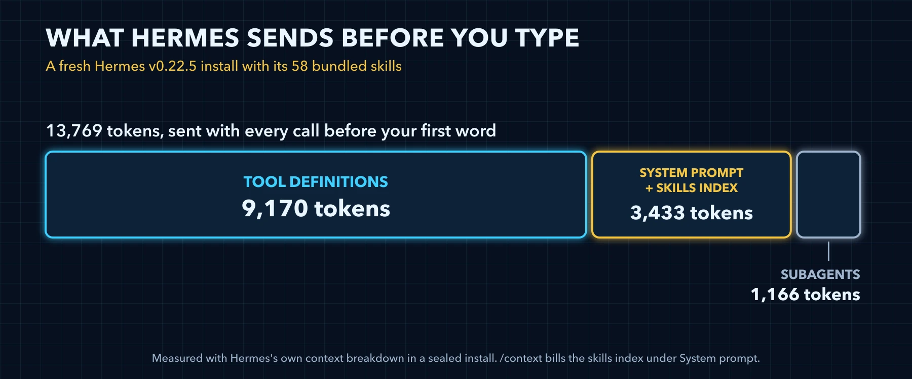

# Stage 0: Measure Before You Change Anything



### What this stage changes

Nothing in your config. You find out what your install sends before your first word, read it with the tools Hermes already has, and save the numbers as a baseline. Every later stage measures against it, and so does the weekly audit in Stage 8.

### What a fresh install sends

Three parts ride on every call before you type. Here is a fresh install of v0.22.5 with the 58 bundled skills, by Hermes's own breakdown:

| Part | Tokens | What it is |
|---|---|---|
| Tool definitions | 9,170 | The JSON schemas of the tools the model can call directly |
| System prompt | 3,433 | Hermes's instructions to the model, with the skills index inside it, about 1,720 tokens on its own |
| Subagent definitions | 1,166 | The schema of delegate_task, the tool that starts subagents |
| Total | 13,769 | Before your first word |

Turn every toolset off and the same install sends 778 tokens. Most of the difference is tool schemas, which is why Stages 1 and 2 come first.

### Three ways to read the budget

| Tool | Where you run it | What it shows | Cost |
|---|---|---|---|
| `/context` | Inside a session | The window by category: system prompt, tool definitions, rules, skills, MCP, subagent definitions, memory and conversation, then free space | Local, no provider call |
| `/context all` | Inside a session | All of that, plus the schema cost of every toolset and the index and load cost of every skill | Local, no provider call |
| `hermes prompt-size` | Your terminal, or Hermes's terminal tool | The fixed budget of a fresh session in bytes: system prompt, skills index, memory, user profile, and tool schemas by toolset; `--json` prints it as JSON, `--platform` simulates a chat platform | Offline, no API call |

All three start from bytes. `/context` divides them by four and rounds up; `hermes prompt-size` prints the bytes, so divide by four yourself. Expect the two to sit about 70 tokens apart on the same config: `hermes prompt-size` builds its tool list without the desktop_project listing line that every live session adds (Stage 1 explains that line).

### The Skills 0 trap

Run `/context` on a fresh install and there is no Skills row, although 58 skills are installed. The category comes out at 0, and a row at 0 is not printed. The index is there; it is billed as System prompt. It sits in the volatile tier of the prompt (`agent/system_prompt.py:785`), while the breakdown looks for it in the stable tier (`agent/context_breakdown.py:152`) and finds nothing. Read skill costs from `/context all` or `hermes prompt-size`, which show the index by itself.

### Reading the sample

This is `/context all` on that fresh install, exactly as Hermes printed it in the sealed run:

*`sample-context-all.txt`*

```text
Conversation is empty (no messages yet).
  user: 0, assistant: 0, tool: 0, system: 0
Model: claude-sonnet-5-5
Provider: auto

Estimated usage by category
■ System prompt        ~    3,433 tokens ~  0.3%
▣ Tool definitions     ~    9,170 tokens ~  0.9%
▦ Subagent definitions ~    1,166 tokens ~  0.1%
▨ Conversation         ~        0 tokens ~  0.0%
· Free space           ~  986,231 tokens ~ 98.6%

Context window: ~13,769 / 1,000,000 tokens (~1%)
Source: local estimate; category counts are local estimates.

Toolsets by schema cost (largest first)
  file                       4 tools ~   1,419 tokens
  skills                     3 tools ~   1,241 tokens
  delegation                 1 tools ~   1,165 tokens
  connections                1 tools ~   1,130 tokens
  browser-use                1 tools ~     831 tokens
  memory                     1 tools ~     821 tokens
  code_execution             1 tools ~     770 tokens
  (unknown)                  3 tools ~     745 tokens
  terminal                   1 tools ~     686 tokens
  web                        2 tools ~     478 tokens
  clarify                    1 tools ~     454 tokens
  tts                        1 tools ~     380 tokens
  vision                     1 tools ~     212 tokens
```

Read three things in it. The Context window line holds the total that every stage moves, 13,769 here. The toolset table is the price list Stage 2 works from, largest first. And the (unknown) row is not an error: it is the tool search bridge from Stage 1, three tools that carry the listing of every deferred tool.

### Money is a different measurement

Tokens before your first word are one number. What a session costs is another, and on v0.22.5 none of Hermes's own displays is audit grade:

| Where | What it gives you | Watch out |
|---|---|---|
| `/usage` | Session tokens and your provider's account limits | It makes a provider call, and it prints no cost line on the CLI or a chat platform, although the docs promise one |
| `/insights`, `hermes insights` | Tokens, estimated cost, models, platforms and top tools, from the local session database | A lower bound, not a bill: totals fold in cache reads and writes, and custom providers price at zero |
| The status bar | Context use, a cache hit percentage, latency | No cost: `display.show_cost` exists in config and nothing reads it |
| The dashboard's analytics | Token and cost charts | Hidden unless `dashboard.show_token_analytics` is true, and its own comment says the totals can be 10x to 100x under the bill |

For money, go to the source: your provider's bill, and the line Hermes writes to agent.log for every API call, which carries that call's cache read and cache write counts.

> ⚠️ **The request dump holds everything**
>
> `HERMES_DUMP_REQUESTS=1` writes full prompts to the sessions folder in your Hermes home, your memory and project context files included. If you use it to see exactly what goes out, delete the dumps when you are done and never share them.

### Diagnostics that spend

Two commands look like the same checkup and are not. `hermes doctor` calls your providers even without `--live`. `hermes status` reads local state only, unless you add `--deep`, which calls out. To check an install without touching a provider, use `hermes status` and the three tools above.

### The stage prompt

Paste this into a session on the profile you are tuning. It measures, proposes saving a baseline, and changes nothing else.

*`prompt-stage-0-measure.md`*

```markdown
Tune Hermes, stage 0: Measure Before You Change Anything. Work in five steps, one change at a time.
MEASURE: Run `hermes config path` to find my config.yaml and `hermes tools list` to see which toolsets are on. Run `hermes prompt-size --json` and show the system prompt bytes, the tool schema bytes and their sum divided by four as estimated tokens.
PROPOSE: Propose saving this measurement as `tune/baseline.json` in the folder that holds config.yaml: the `hermes prompt-size --json` output with two more top-level keys, `date` for today's date as YYYY-MM-DD and `version_label` for the first line of `hermes --version`. Show the exact command, or the exact lines of config.yaml before and after, and say in one line what it saves and what it costs me. Never put a key, token or password into config.
WAIT: Change nothing until I reply yes.
APPLY: Copy config.yaml to a dated backup next to it with `cp -p config.yaml config-YYYY-MM-DD-HHMMSS.yaml` in its folder, never overwriting an earlier backup, then make only the change I approved.
VERIFY: Read `tune/baseline.json` back and confirm it holds the bytes you showed me, today's `date` and the `version_label`. Run `hermes prompt-size --json` again and show a table with before, after and the difference. Remind me that this session keeps its old prompt and that a new session shows the change with /context all.
If you have no terminal tool in this session, give me each command to run and wait for my output.
```

### Verify

- [ ] `hermes prompt-size` ran offline and showed the system prompt bytes and the tool schema bytes
- [ ] tune/baseline.json sits in the folder with config.yaml, with `date` set to today and `version_label` set to the first line of `hermes --version`
- [ ] A new session's `/context all` shows your own toolset table, and you can name your three most expensive toolsets
- [ ] You know why `/context` shows no Skills row, and where the index is billed instead
- [ ] No request dump is left in your sessions folder

---

[← Back to the index](../README.md) · [Whole volume in one file](FULL-HERMES-TUNING.md)
