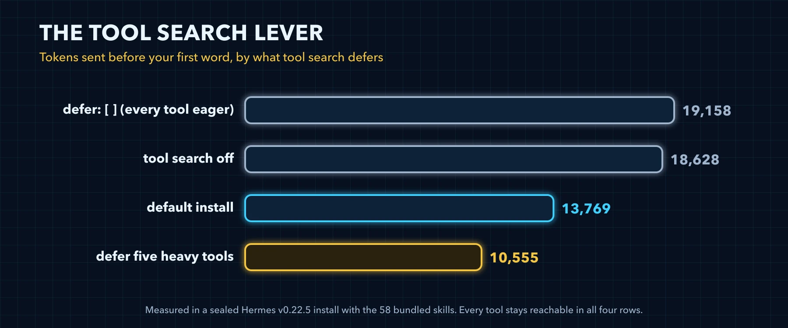

# Stage 1: Defer What You Rarely Call



### What this stage changes

One list in config.yaml, `tools.tool_search.defer`. Five heavy tools move behind tool search, which takes a fresh install from 13,769 tokens to 10,555, 23 percent less, and every tool stays one search away. It is the largest cut in this volume that takes nothing away, so it comes before anything that does.

### How tool search works

Tool search is on by default: `tools.tool_search.enabled` is `auto`, which means on. A deferred tool leaves the tool array the model sees. In its place, three bridge tools, tool_search, tool_describe and tool_call, carry a compact listing: each deferred tool's name and the first sentence of its description, cut at 60 characters. When the model needs a deferred tool, it finds it in the listing and calls it through the bridge.

Out of the box, the curated list defers computer_use, session_search, image_generate, todo_list, process_manage, cronjob_manage, browser_vault and twelve desktop app tools. MCP and plugin tools always defer while the bridge is on. A core tool defers only when the list names it.

That is the (unknown) row in `/context all`: 3 tools, 745 tokens. The bridge tools belong to no toolset, so Hermes has no name for the row. It is also why any session with a toolset on pays a floor of about 568 tokens: the bridge costs 498 tokens bare, and every live session adds a listing line for desktop_project, which is on the curated list.

| Setting | Default | What it does |
|---|---|---|
| `tools.tool_search.enabled` | `auto` | `auto` and `on` run the bridge; `off` sends every schema on every call |
| `tools.tool_search.defer` | The curated list | The core tools that sit behind the bridge |
| `tools.tool_search.listing_max_tokens` | `4000` | The listing's ceiling in tokens |
| `tools.tool_search.threshold_pct` | `5` | The listing's ceiling as a percent of the context window; the smaller ceiling wins |
| `tools.tool_search.search_default_limit` | `5` | Results per search when the model does not ask for a number |
| `tools.tool_search.max_search_limit` | `25` | The most results one search can return |

### What we measured

Four settings on the same fresh install, every tool reachable in all four:

| Setting | Tokens before your first word | Against the default |
|---|---|---|
| `defer: []`, every tool eager | 19,158 | plus 5,389 |
| Tool search off | 18,628 | plus 4,859 |
| The default install | 13,769 |  |
| Five heavy tools deferred as well | 10,555 | minus 3,214, 23 percent less |

Turning tool search off to keep things simple costs 4,859 tokens on every call. An empty defer list costs even more.

### The replace rule

An explicit defer list replaces the curated one; it does not add to it (`hermes_cli/config_defaults.py:2032-2039`). Write `defer: [delegate_task]`, or set that one-name list with `hermes config set`, and the curated tools all go eager again. So copy the curated list first and append, and write `defer: []` only if you mean every tool eager.

### The ready list

This is the curated list, in order, with the five heavy tools appended: the setting measured above at 10,555. To set it by hand, merge it into config.yaml; if you already have a tools section, put the defer line under its tool_search part.

*`defer-heavy.yaml`*

```yaml
# defer-heavy: the curated default names first, then five heavy tools. Hermes applies it with hermes config set tools.tool_search.defer '<JSON list>', the list as JSON with no spaces (references/ladder.md, Stage 1); merging it into config.yaml by hand is the user's path. Measured in Volume 6, Stage 1.
tools:
  tool_search:
    defer: ["computer_use", "session_search", "image_generate", "todo_list", "process_manage", "cronjob_manage", "browser_vault", "drive_preview", "gui_tour", "desktop_preview", "annotate_preview", "manage_catalog", "show_tip", "desktop_project", "close_terminal", "set_theme", "read_terminal", "read_window_below", "focus_pane", "manage_connections", "browser_exec", "text_to_speech", "vision_analyze", "execute_code"]
```

Or set the same list with one command, the way the stage prompt applies it. The list replaces whatever list is there, which is why it starts with every curated name:

*`defer-heavy.sh`*

```bash
hermes config set tools.tool_search.defer '["computer_use","session_search","image_generate","todo_list","process_manage","cronjob_manage","browser_vault","drive_preview","gui_tour","desktop_preview","annotate_preview","manage_catalog","show_tip","desktop_project","close_terminal","set_theme","read_terminal","read_window_below","focus_pane","manage_connections","browser_exec","text_to_speech","vision_analyze","execute_code"]'
```

Deferring a tool does not turn it off. Its toolset stays on, and the tool is one search away:

| Deferred tool | Its toolset | Its schema in /context all |
|---|---|---|
| manage_connections | connections | 1,130 |
| browser_exec | browser, shown as browser-use | 831 |
| execute_code | code_execution | 770 |
| text_to_speech | tts | 380 |
| vision_analyze | vision | 212 |

### The trade-off

A deferred tool still costs its listing line, about 25 tokens, and each use costs the model a search round trip. The first time a session needs it, the bridge takes 3 to 5 calls to find and run it. So defer what is heavy and occasional, and keep eager what runs every session. If you write code every session, take execute_code off the list: you would pay that round trip every time.

### The stage prompt

It reads your defer list and your recent tool use, proposes one list, and waits for your yes.

*`prompt-stage-1-defer.md`*

```markdown
Tune Hermes, stage 1: Defer What You Rarely Call. Work in five steps, one change at a time.
MEASURE: Run `hermes config get tools.tool_search.enabled` and `hermes config get tools.tool_search.defer`, and use `hermes insights --days 30` to see how often I used manage_connections, browser_exec, text_to_speech, vision_analyze and execute_code. Run `hermes prompt-size --json` and show the system prompt bytes, the tool schema bytes and their sum divided by four as estimated tokens.
PROPOSE: Propose one `hermes config set tools.tool_search.defer '<JSON list>'` command, the list written as JSON with no spaces, that keeps every name already in the list, in order, and appends whichever of those five tools I do not use every session, because the list you set replaces the whole setting instead of adding to it. If tool search is off, propose only `hermes config set tools.tool_search.enabled auto`. Apply it with that command and never edit config.yaml with write_file or patch, which Hermes refuses. Show the exact command, or the exact lines of config.yaml before and after, and say in one line what it saves and what it costs me. Never put a key, token or password into config.
WAIT: Change nothing until I reply yes.
APPLY: Copy config.yaml to a dated backup next to it with `cp -p config.yaml config-YYYY-MM-DD-HHMMSS.yaml` in its folder, never overwriting an earlier backup, then make only the change I approved.
VERIFY: Run `hermes config get tools.tool_search.defer` and confirm that every name from before is still in the list. Run `hermes prompt-size --json` again and show a table with before, after and the difference. Remind me that this session keeps its old prompt and that a new session shows the change with /context all.
If you have no terminal tool in this session, give me each command to run and wait for my output.
```

### Verify

- [ ] `hermes config get tools.tool_search.defer` lists every curated name, then the heavy tools you chose
- [ ] `hermes prompt-size` shows fewer tool schema bytes than your baseline
- [ ] In a new session, `/context all` shows a smaller total and a larger (unknown) row
- [ ] A task that needs a deferred tool still works: Hermes finds it through tool search

---

[← Back to the index](../README.md) · [Whole volume in one file](FULL-HERMES-TUNING.md)
