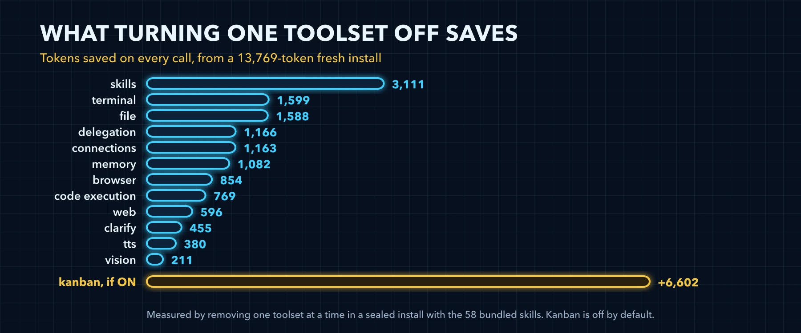
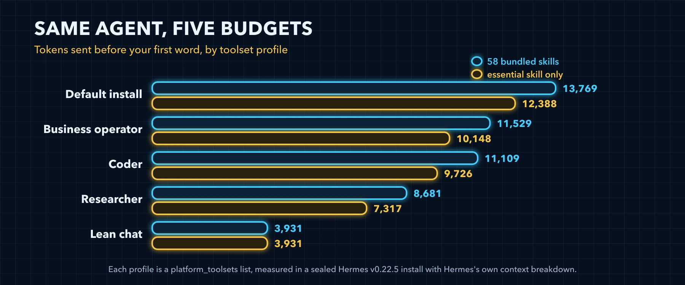

# Stage 2: Pick a Toolset Profile



### What this stage changes

The toolsets your CLI turns on, written as one list in config.yaml. A toolset you turn off stops sending its schemas, and any text the system prompt carries for it, on every call. Unlike Stage 1 this takes capabilities away, so pick by the work you do and keep what you use.

### What each toolset costs

Turning off one default toolset at a time on the fresh install saves what the second column shows. The third column is Hermes's own schema price from `/context all`.

| Toolset | Turning it off saves | Its schemas in /context all | What you lose |
|---|---|---|---|
| skills | 3,111 | 1,241, 3 tools | Loading, listing and writing skills, and the skills index |
| terminal | 1,599 | 686 | Shell commands and background processes; the stage prompts then ask you to run their commands |
| file | 1,588 | 1,419, 4 tools | Reading, writing, patching and searching files |
| delegation | 1,166 | 1,165, billed as subagent definitions | Subagents |
| connections | 1,163 | 1,130 | Hosted app connectors and their accounts |
| memory | 1,082 | 821 | Saving to memory; what MEMORY.md and USER.md already hold stays in the prompt (Stage 4) |
| browser | 854 | 831, as browser-use | Browser automation |
| code_execution | 769 | 770 | Python scripts that call tools |
| web | 596 | 478, 2 tools | Web search and page extraction |
| clarify | 455 | 454 | Clarifying questions with choices |
| tts | 380 | 380 | Text to speech |
| vision | 211 | 212 | Image analysis |
| cronjob | 28 | Deferred, inside the (unknown) row | Managing cron jobs from a session |
| session_search | 25 | Deferred, inside the (unknown) row | Searching past sessions |
| computer_use | 25 | Deferred, inside the (unknown) row | Desktop control |
| todo | 20 | Deferred, inside the (unknown) row | The task list for multi-step work |
| image_gen | 0 | None: gated until an image provider is set up, and deferred | Image generation |

The two columns differ because the saving is everything that leaves the request, not only the schemas: turning skills off removes the whole skills index along with its three tools, and a toolset's saving also covers any text the system prompt carries for it. Delegation is the case where the two match: its one schema is nearly its whole cost.

Kanban is off by default, and turning it on adds 6,602 tokens. The toolsets that are already deferred save only 20 to 28 tokens each, their listing lines, so turning them off buys almost nothing.



### Four ready profiles

Three profiles cover the four kinds of work, with operator serving both running a business and automating a company, and the fourth, lean chat, cuts Hermes down to chat in the terminal. Each was measured on the cli platform, on exactly the list shown, with the 58 bundled skills and with only the one essential skill that Stage 3 explains.

| Your work | Profile | Toolsets | Tokens, 58 bundled skills | Tokens, essential skill only | You give up |
|---|---|---|---|---|---|
| Agentic coding | coder | terminal, file, code_execution, web, skills, memory, todo, clarify, session_search, delegation | 11,109 | 9,726 | browser, vision, image_gen, tts, connections, cronjob, computer_use |
| Research | researcher | web, browser, file, memory, skills, session_search, clarify, todo, vision | 8,681 | 7,317 | terminal, code_execution, image_gen, tts, connections, delegation, cronjob, computer_use |
| Running a business or automating a company | operator | web, file, memory, skills, cronjob, clarify, todo, session_search, delegation, connections, terminal | 11,529 | 10,148 | browser, code_execution, vision, image_gen, tts, computer_use |
| Chat in the terminal | lean chat | web, memory, clarify, session_search, todo | 3,931 | 3,931 | browser, terminal, file, code_execution, vision, image_gen, tts, skills, connections, delegation, cronjob, computer_use |
| Anything, untuned | the default | All 17 default toolsets | 13,769 | 12,388 | Nothing |

Lean chat sends 71 percent less than the default, and the same with either skill set, because a profile without the skills toolset has no skills index at all. Its 3,931 is a CLI figure, like every figure in the table. A phone gateway takes the same list under its own platform, in `platform_toolsets.telegram` for Telegram or with `hermes tools disable --platform telegram` and the same names, and this volume did not measure that budget.

Each profile is a list to merge into config.yaml by hand. The files live in the [hermes-tune skill](https://github.com/jasonjeske/hermes-master-class/tree/main/skills/hermes-tune/references/profiles), so the skill and this page show the same lists:

*`coder.yaml`*

```yaml
# coder: agentic coding. Hermes applies this platform_toolsets.cli list with hermes config set platform_toolsets.cli '<JSON list>', the list as JSON with no spaces (references/ladder.md, Stage 2); merging it into config.yaml by hand is the user's path. Measured on the CLI in Volume 6, Stage 2.
platform_toolsets:
  cli:
    - terminal
    - file
    - code_execution
    - web
    - skills
    - memory
    - todo
    - clarify
    - session_search
    - delegation
```

*`researcher.yaml`*

```yaml
# researcher: research and reading. Hermes applies this platform_toolsets.cli list with hermes config set platform_toolsets.cli '<JSON list>', the list as JSON with no spaces (references/ladder.md, Stage 2); merging it into config.yaml by hand is the user's path. Measured on the CLI in Volume 6, Stage 2.
platform_toolsets:
  cli:
    - web
    - browser
    - file
    - memory
    - skills
    - session_search
    - clarify
    - todo
    - vision
```

*`operator.yaml`*

```yaml
# operator: running a business or automating a company. Hermes applies this platform_toolsets.cli list with hermes config set platform_toolsets.cli '<JSON list>', the list as JSON with no spaces (references/ladder.md, Stage 2); merging it into config.yaml by hand is the user's path. Measured on the CLI in Volume 6, Stage 2.
platform_toolsets:
  cli:
    - web
    - file
    - memory
    - skills
    - cronjob
    - clarify
    - todo
    - session_search
    - delegation
    - connections
    - terminal
```

*`lean-chat.yaml`*

```yaml
# lean chat, a lean terminal profile: plain chat with no files, terminal or skills. Hermes applies this platform_toolsets.cli list with hermes config set platform_toolsets.cli '<JSON list>', the list as JSON with no spaces (references/ladder.md, Stage 2); merging it into config.yaml by hand is the user's path. Measured on the CLI in Volume 6, Stage 2; on a phone gateway the same list goes under that platform, for example platform_toolsets.telegram, and that was not measured.
platform_toolsets:
  cli:
    - web
    - memory
    - clarify
    - session_search
    - todo
```

Or reach the same list from a default install with one command, the way the stage prompt applies it. None of the four names `--platform`, so each changes the CLI's list, `platform_toolsets.cli`, the lean chat command included:

*`coder.sh`*

```bash
hermes tools disable browser vision image_gen tts connections cronjob computer_use
```

*`researcher.sh`*

```bash
hermes tools disable terminal code_execution image_gen tts connections delegation cronjob computer_use
```

*`operator.sh`*

```bash
hermes tools disable browser code_execution vision image_gen tts computer_use
```

*`lean-chat.sh`*

```bash
hermes tools disable browser terminal file code_execution vision image_gen tts skills connections delegation cronjob computer_use
```

### Applying a profile

`hermes tools disable` saves your choice as an explicit `platform_toolsets.cli` list in config.yaml. In our test config it also rewrote the model block as it saved: the `model:` line inside it became a `default:` line. Expect both in the diff against your dated backup.

The top-level `toolsets:` key is legacy; editing it changes nothing, so use `platform_toolsets.cli` or `hermes tools` instead. `agent.disabled_toolsets` is the other lever: it subtracts toolsets on every platform at once, after everything else, so it always wins. It reaches cron too: every cron job loses those toolsets, whatever toolsets the job names, and nothing warns you (`cron/scheduler.py:414-433`). Put terminal there and the weekly audit in Stage 8, which runs on the terminal and file toolsets, can no longer run the commands it measures with.

Each chat platform keeps its own list. Add `--platform telegram` to `hermes tools disable` to trim Telegram's, which lands in `platform_toolsets.telegram`, and measure it with `hermes prompt-size --platform telegram --json`. Giving every platform its own smaller toolset is a habit [witcheer](https://x.com/witcheer/status/2089706892993941840) recommends.

A toolset profile is a list inside one Hermes home. It is not a Hermes profile, the separate homes of [Volume 1, Build 7](https://github.com/jasonjeske/hermes-master-class/blob/main/masterclass/build-07-profiles.md). To give one of those a toolset profile, start the command with `hermes -p <name>`, as in `hermes -p coder tools disable browser vision image_gen tts connections cronjob computer_use`.

To pick from your own history, run `hermes insights --days 30`: its top tools show what you actually use. A toolset whose tools never appear there is a candidate to turn off.

Whatever you change lands next session. The session you change it from keeps its tool list until it ends, so open a new one before you measure with `/context`.

### The stage prompt

It reads your toolsets and your recent tool use, proposes one profile, and waits for your yes.

*`prompt-stage-2-profile.md`*

```markdown
Tune Hermes, stage 2: Pick a Toolset Profile. Work in five steps, one change at a time.
MEASURE: Run `hermes tools list` to see which toolsets are on and `hermes insights --days 30` to see which tools I used in the last 30 days. Run `hermes prompt-size --json` and show the system prompt bytes, the tool schema bytes and their sum divided by four as estimated tokens.
PROPOSE: Propose the one profile that fits how I use you, as the `hermes tools disable` command that gets there from what is on now (with `hermes tools enable` for anything it keeps that is off), and name every toolset it turns off that I used in the last 30 days. The profiles keep these toolsets: coder keeps terminal, file, code_execution, web, skills, memory, todo, clarify, session_search and delegation; researcher keeps web, browser, file, memory, skills, session_search, clarify, todo and vision; operator keeps web, file, memory, skills, cronjob, clarify, todo, session_search, delegation, connections and terminal; lean chat keeps web, memory, clarify, session_search and todo. Apply it with those commands and never edit config.yaml with write_file or patch, which Hermes refuses. Show the exact command, or the exact lines of config.yaml before and after, and say in one line what it saves and what it costs me. Never put a key, token or password into config.
WAIT: Change nothing until I reply yes.
APPLY: Copy config.yaml to a dated backup next to it with `cp -p config.yaml config-YYYY-MM-DD-HHMMSS.yaml` in its folder, never overwriting an earlier backup, then make only the change I approved.
VERIFY: Run `hermes tools list` again and confirm that exactly the profile's toolsets are on. Run `hermes prompt-size --json` again and show a table with before, after and the difference. Remind me that this session keeps its old prompt and that a new session shows the change with /context all.
If you have no terminal tool in this session, give me each command to run and wait for my output.
```

### Verify

- [ ] `hermes tools list` shows exactly the toolsets of the profile you picked
- [ ] config.yaml holds an explicit `platform_toolsets.cli` list, and a dated `config-YYYY-MM-DD-HHMMSS.yaml` backup beside it holds the old config
- [ ] `hermes prompt-size` shows fewer tool schema bytes than after Stage 1
- [ ] A new session still does the work you picked the profile for
- [ ] Every chat platform you use has its own list, measured with `--platform`

---

[← Back to the index](../README.md) · [Whole volume in one file](FULL-HERMES-TUNING.md)
